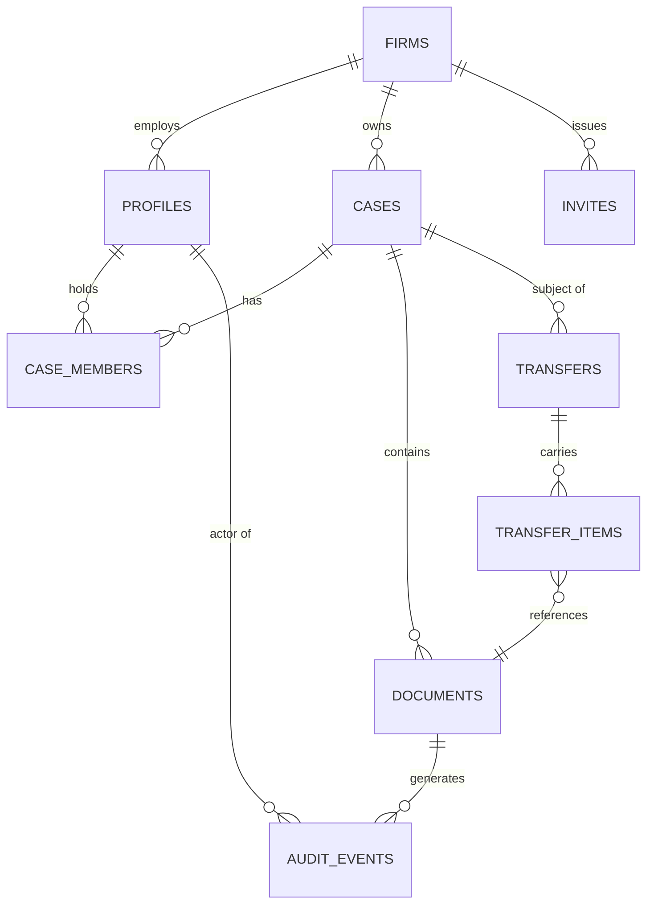

# BriefLock — Contract (v3.0)

> **Status:** LOCKED — the single normative source of truth for the project.
> **Supersedes:** `DECISIONS.md` + `DOMAIN_MODEL.md` (v2.0) entirely, and the mechanics sections of `ARCHITECTURE.md` / `DATABASE_SCHEMA.md` / `API_SPEC.md` wherever they conflicted.
> **Rule:** Code implements this file. All v2 documents are frozen reference in `docs/`; where a frozen doc contradicts this file, **this file wins** — do not regenerate anything, just follow this file.
> **Corrections applied during consolidation:** see §0.

---

## 0. Corrections register (v2 → v3)

| # | v2 conflict | Canonical resolution |
|---|---|---|
| 1 | Upload flow: `ARCHITECTURE` says multipart through the API route; `API_SPEC` says two-step. Vercel caps request bodies at ~4.5 MB — a 100 MB PDF cannot traverse the API. | **Two-step flow** (§9.1): `POST …/documents/upload-intent` → direct signed PUT to private Storage → `POST /documents/{id}/complete`. |
| 2 | Delivery: `ARCHITECTURE` says the API "streams passthrough"; `API_SPEC` returns signed-URL JSON. | **Signed-URL JSON only.** The app never proxies content bytes (§9.4). |
| 3 | Hash chain: computed in `lib/audit` (TS), in a DB trigger, and "via pgcrypto" in three docs. | **DB trigger is canonical** (§8.2); the app only inserts event fields. |
| 4 | Chain verify cadence: 5-min (ARCHITECTURE) vs nightly (ROADMAP) vs daily (DATABASE_SCHEMA). | **Daily 03:00 via app cron** (§13) — outbound alerting needs the app. |
| 5 | pg_cron "signed-URL cleanup" job — not implementable (signed URLs are stateless; cannot be enumerated or revoked). | **Removed.** TTL ≤ 60 s is the exposure bound. |
| 6 | Retention sweep: pure SQL "deletes the storage object" — pg_cron cannot call the Storage API; purge events absent from the closed audit enum. | **Split** (§13/§14): pg_cron marks candidates; app job deletes objects + tombstones rows; audit enum amended with `document.purged` (24 values). |
| 7 | Level raise: P2 says uploader; API_SPEC/DATABASE_SCHEMA say any case member. | **Uploader only** (P2 literal). Lower = `firm_admin` + reason. |
| 8 | A6 archived-case semantics muddled (reads allowed? downloads?). | **Mutations denied** (`CASE_ARCHIVED`); **view/download continue** under the normal gates (§5). |
| 9 | Repo layout: root `app/` vs `src/app/`; `db/migrations` vs `supabase/migrations`. | **Root `app/`** layout + `supabase/migrations/` (§17). |
| 10 | `.env.example` missing most server vars. | Full inventory in §18 / `.env.example`. |
| 11 | Data fetching: TECH_STACK says TanStack Query + Zustand; FRONTEND_ARCH says SWR, no Zustand. | **SWR** for client polling/revalidation; no Zustand (no cross-page client state). Server Components own all reads. |
| 12 | Probe handling: ARCHITECTURE says every denial including nonexistent/cross-firm UUID probes writes an audit row; API_SPEC says 404 with no audit row. Audit rows `references documents(id)` — a nonexistent UUID cannot be audited; RLS hides cross-firm rows entirely. | **Uniform 404, no audit row** for unknown/cross-firm IDs; rate limiting + RLS are the probe controls. Real denials (existing doc, authenticated caller) always audit. |
| 13 | L3 download denial: ARCHITECTURE says generic 403 body; API_SPEC returns distinct `DOWNLOAD_BLOCKED_L3`. | **Distinct 403 code** for the L3 gate only — the caller already passed A1–A6, so no existence oracle (§16). |

---

## 1. Product definition

BriefLock is a **secure document exchange and case-file management platform for law firms**. Firms (tenants) create legal cases, upload case PDFs tagged with a **security level** (L1 standard / L2 high / L3 maximum), and exchange documents with other firms through **audited, acceptance-gated transfers**.

Every user holds **exactly one clearance level**. Content access requires **all** of:

1. The user belongs to the owning firm **or** was granted access via an accepted transfer;
2. The user is a member of the case;
3. The user's clearance level **exactly equals** the document's security level — **compartments, not a hierarchy** (L3 cannot open L2; L2 cannot open L3);
4. The document passed the scan gate (`scan_status = 'clean'`).

Every access, every **denial**, and every administrative change is recorded in an **immutable, hash-chained audit log**. There is no unauthenticated access to anything in MVP.

---

## 2. Locked decisions (register)

| ID | Decision |
|----|----------|
| D2 | **Vercel-only deployment.** Domain TBD — `app.example.com` placeholders. Sole infra exception: the D11 ClamAV container (fast-follow). |
| D6 | **Cron:** Supabase `pg_cron` for pure-SQL sweeps + `CRON_SECRET`-protected app endpoints; lazy read-time checks are the real enforcer. |
| D7 | **Rate limiting:** in-memory per-instance token bucket behind a `RateLimiter` interface (Upstash-ready). |
| D8 | **GeoIP:** Vercel request geo headers only; no third-party GeoIP. |
| D9 | **IP privacy:** salted SHA-256 `ip_hash` at ingest; raw IPs never persisted; store country/city. |
| D10 | **Auth:** Supabase Auth (email/password + magic link); no custom auth endpoints; JWT Bearer; roles `firm_admin` \| `lawyer` \| `paralegal`. |
| D11 | **Scanning:** in-function PDF structure validation (magic bytes, embedded-JS heuristics) + quarantine-until-scanned. ClamAV container = fast-follow. Never third-party scanning APIs. |
| P1 | **Clearance semantics:** exact-match compartments, non-hierarchical. Hierarchical toggle noted, not built. |
| P2 | **Levels:** case carries a default level; **uploader may raise** a document (audited, correction 7); lowering requires `firm_admin` with reason (audited). |
| P3 | **Transfers:** one-way, acceptance-gated; acceptance inserts `external` case members; revoke severs future access. |
| P4 | **Access surface:** authenticated app only; anonymous pages = login/signup/invite-accept only. Share links are a fast-follow. |
| P5 | **L3:** watermarked view + download by default; per-case `allow_l3_download = false` switches to view-only (download denied + logged). |
| P6 | **Clearance:** exactly one per user. |
| P7 | **Firm admins:** metadata + audit visibility only; no content backdoor. |
| P8 | **Compliance:** security baseline + GDPR-aligned (processor posture, DPA template, legal hold, retention). SOC 2 post-MVP. |
| W1 | **Watermark:** viewer full name + UTC timestamp; mandatory L2/L3, optional L1. |
| A1 | **Audit integrity:** append-only, hash-chained, service-role insert only; content-access events commit **synchronously before** the signed URL; denials carry reason codes. |
| S1 | **SLOs (p95):** signed-URL issuance < 100 ms · API < 200 ms · dashboard initial load < 2 s · uptime 99.9%. |
| N1 | **Naming:** `document` (never "link") · `security_level` · `clearance_level` · `transfer` · `audit_event`; `/api/v1` prefix; UUID identifiers. |
| V1 | **Immutability:** uploaded documents are immutable; replacement = new upload; case/metadata edits audited. |

---

## 3. Out of scope (MVP)

Secure share links · SSO/SAML · e-signature · document editing/versioning · OCR · folders/tags · deadlines & calendars · billing automation (seat-based pricing designed; invoicing manual) · mobile apps · multi-firm shared case workspaces (v2) · hierarchical clearances (future toggle) · chat/comments.

---

## 4. Domain model

### 4.1 Entities



### 4.2 Tables

**`firms`** — tenant root. `id uuid pk` · `name text` · `slug citext unique` · `settings jsonb` (retention_days, retention_mode, watermark defaults, l3_view_only default) · `plan text default 'trial'` · `created_at` · `deactivated_at`.

**`profiles`** (extends `auth.users`, 1:1) — `id uuid pk = auth.users.id` · `firm_id fk→firms` · `email citext` · `full_name text` · `role text check in ('firm_admin','lawyer','paralegal')` · `clearance_level int check in (1,2,3)` · `is_active boolean default true` · `created_at` · `deactivated_at`.
Exactly one clearance per user (P6). `lawyer` vs `paralegal` is an organizational label in MVP — no access-rule difference (admin checks are the only role checks). Deactivation sets `is_active = false` + `deactivated_at`; the row is never deleted (A1 fails with `DEACTIVATED`). Role/clearance changes are admin-only and always audited.

**`invites`** — `id uuid pk` · `firm_id fk` · `email citext` · `role check (firm_admin|lawyer|paralegal)` · `clearance_level int check 1–3` · `token_hash text unique` (SHA-256 of the emailed token; **raw token never stored**) · `created_by fk→profiles` · `created_at` · `expires_at default now() + 7 days` · `accepted_at`.
Acceptance copies role + clearance into the new profile, stamps `accepted_at`, audits `member.added`. Revocation deletes the row; the emailed token then fails as unknown (no existence oracle).

**`cases`** — `id uuid pk` · `firm_id fk` · `title text 1–300` · `case_reference text` (firm-local; `unique (firm_id, case_reference)`) · `default_security_level int check 1–3` (applies to **future uploads only**) · `status check ('open','closed','archived') default 'open'` · `allow_l3_download boolean default true` (P5) · `legal_hold boolean default false` · `retention_days int null check > 0` · `created_by fk→profiles` · `created_at` · `closed_at`.

**`case_members`** — `(case_id, user_id) pk` · `role check ('lead','member','external') default 'member'` · `added_by fk→profiles` · `added_at`.
`external` rows are created **only** by the transfer-acceptance path (service role) and removed only by transfer revoke — never by the member-management endpoints.

**`documents`** — `id uuid pk` · `case_id fk` · `firm_id fk` (owning firm, denormalized for RLS) · `filename text 1–255` · `storage_path text unique` (`{firm_id}/{case_id}/{document_id}/{filename}`) · `size_bytes bigint ≤ 104857600` · `mime_type = 'application/pdf'` · `sha256 char(64)` · `security_level int check 1–3` · `scan_status check ('pending','clean','infected','error') default 'pending'` · `scan_method text default 'magic-bytes-mvp'` (→ `'clamav'` fast-follow) · `description text ≤ 2000 null` · `uploaded_by fk→profiles` · `uploaded_at` · `superseded boolean default false`.
Immutable content (V1). Only `security_level` (raise = uploader; lower = admin + reason), `description` (admin), and `superseded` ever change — always via server routes using the service role, always audited. No client-role UPDATE policy exists.

**`transfers`** — `id uuid pk` · `case_id fk` · `from_firm_id fk` · `to_firm_id fk` (`≠ from_firm_id`) · `created_by fk→profiles` · `recipient_user_ids uuid[] check length 1–10` · `status check ('draft','sent','accepted','rejected','cancelled','revoked') default 'draft'` · `message text ≤ 1000 null` · `sent_at` · `responded_at` · `created_at`.
Legal transitions are enforced by the API **and** the DB trigger `trg_transfer_guard` (second line of defense).

**`transfer_items`** — `(transfer_id, document_id) pk`; `transfer_id` cascades on delete.

**`audit_events`** (append-only) — `id uuid pk` · `chain_seq bigint generated always as identity` · `occurred_at timestamptz` · `actor_user_id fk null` (null = system) · `firm_id fk null` (null = platform-level, e.g. `auth.login_failed`) · `case_id` · `document_id` · `transfer_id` · `action` (§4.4) · `result check ('allow','deny','info')` · `deny_reason` (§4.5, set only when `result='deny'`) · `ip_hash char(64) null` (salted SHA-256, D9) · `country` / `city` null · `user_agent ≤ 200` · `details jsonb` · `prev_hash char(64)` · `entry_hash char(64) unique`.
**No UPDATE/DELETE policies or grants exist for any role.** Insert = service role only. Retained indefinitely; NDJSON export for cold archive.

### 4.3 The Access Rule (normative)

Content access is granted **iff all** checks pass, evaluated server-side on every request (identity from JWT — clearance/firm/role always re-read from `profiles`):

| # | Check | Failure reason |
|---|-------|----------------|
| A1 | Authenticated, `is_active = true` | `UNAUTHENTICATED` / `DEACTIVATED` |
| A2 | `profile.firm_id = document.firm_id` **OR** profile ∈ `recipient_user_ids` of an **accepted** transfer carrying this document | `FIRM_MISMATCH` |
| A3 | Active `case_members` row for `(document.case_id, profile.id)` | `NOT_CASE_MEMBER` |
| A4 | `profile.clearance_level = document.security_level` (exact match, P1) | `CLEARANCE_MISMATCH` |
| A5 | `document.scan_status = 'clean'` | `UNSCANNED` / `INFECTED` |
| A6 | Case not `archived` **for mutations**; view/download continue under the normal gates (correction 8) | `CASE_ARCHIVED` |

- **Admin exception (P7):** admins may read metadata + audit of their firm; **never** content unless A1–A5 pass for them too.
- **L3 download gate (P5):** if `security_level = 3` AND `case.allow_l3_download = false` → view allowed (watermarked), download denied with distinct `DOWNLOAD_BLOCKED_L3` (correction 13), audited as a denial.
- **Denials:** every skip/deny for an **existing** document by an authenticated caller writes an `audit_events` row (`result='deny'`, canonical `deny_reason`). Unknown or cross-firm document UUIDs → uniform `404`, no audit row (correction 12); rate limiting + RLS are the probe controls.
- **Uniform body:** all A2–A6 failures return generic `403 ACCESS_DENIED`; the specific reason lives only in `audit_events` (anti-probing).

### 4.4 Clearance levels

| Level | Name | Example matter | Handling |
|---|---|---|---|
| 1 | Standard | Property theft, contracts | Watermark optional (firm setting) |
| 2 | High | Murder case | Watermark mandatory |
| 3 | Maximum | War crimes | Watermark mandatory; per-case download gate |

### 4.5 Clearance matrix (the product's core invariant)

| User \ Document | L1 | L2 | L3 |
|---|---|---|---|
| **L1** | view + download | denied (`CLEARANCE_MISMATCH`) | denied |
| **L2** | denied | view + download (watermark) | denied |
| **L3** | denied | denied | view + download (watermark; per-case view-only flag) |

Only the diagonal allows access. Every off-diagonal attempt is a logged denial.

### 4.6 Audit action enum (canonical, 24 values)

`auth.login_failed` · `member.added` · `member.removed` · `member.role_changed` · `clearance.changed` · `case.created` · `case.updated` · `case.closed` · `case.archived` · `document.uploaded` · `document.viewed` · `document.downloaded` · `document.access_denied` · `document.level_raised` · `document.level_lowered` · `document.scan_failed` · `document.purged` *(added v3 — correction 6)* · `transfer.created` · `transfer.sent` · `transfer.accepted` · `transfer.rejected` · `transfer.cancelled` · `transfer.revoked` · `firm.updated`

### 4.7 Deny reason enum (canonical, 9 values)

`UNAUTHENTICATED` · `DEACTIVATED` · `FIRM_MISMATCH` · `NOT_CASE_MEMBER` · `CLEARANCE_MISMATCH` · `UNSCANNED` · `INFECTED` · `CASE_ARCHIVED` · `DOWNLOAD_BLOCKED_L3`

---

## 5. Transfer state machine

```
draft ──send──▶ sent ──accept──▶ accepted ──revoke (owning-firm admin)──▶ revoked
                 │
                 ├─reject──▶ rejected
                 └─cancel──▶ cancelled
```

- `send`: sender = owning-firm case member; recipients designated from the receiving firm's active profiles (1–10); email on send.
- `accept`/`reject`: designated recipients only. Acceptance inserts `external` case members (**idempotent**) and audits `transfer.accepted`. Access then flows through the **full** A1–A6 rule — A2 satisfied via `recipient_user_ids` of an accepted transfer; clearance + scan + L3 gates unchanged.
- `revoke` (owning-firm admin only): severs future access immediately — A2 is re-evaluated live, never cached. Past access remains fully audited.
- Every transition is audited with `transfer_id`; DB trigger `trg_transfer_guard` rejects illegal transitions.
- `reject`/`cancel`/`revoke` notify the sender / recipients per §11.

---

## 6. Audit integrity (A1)

### 6.1 Append-only guarantees
- No UPDATE/DELETE policies for any client role; `revoke update, delete on audit_events from anon, authenticated`.
- Inserts happen **only** via the service role from the audit writer path.
- `document.viewed` / `document.downloaded` rows must be **committed synchronously before** any signed URL is issued.

### 6.2 Hash chain (canonical — DB trigger, correction 3)

- `entry_hash = SHA256(prev_hash ‖ canonical_json(event))`; genesis `prev_hash` = 64 zeros.
- Canonical JSON = `jsonb_build_object` over all fields except `prev_hash`/`entry_hash` (jsonb key order is deterministic — length, then bytewise), emitted via `::text`.
- A `BEFORE INSERT` trigger serializes inserts with `pg_advisory_xact_lock(hashtext('brieflock:audit_chain'))`, reads the previous `entry_hash` by `chain_seq desc`, sets `prev_hash` (genesis → zeros) and `entry_hash`.
- The app inserts event fields only; it never computes hashes.

### 6.3 Verification
- `audit_chain_verify()` recomputes every row and asserts linkage (`lag(entry_hash)` = `prev_hash`, genesis rule at `chain_seq = 1`).
- Production: **daily 03:00 app cron** (§13) runs verify and alerts on any break.
- CI: a tamper test (mutate a row copy → verification fails) is a release gate (§19).

### 6.4 Privacy
`ip_hash` = salted SHA-256 at ingest (salt = `IP_HASH_SALT`; rotation breaks historical hashes — documented tradeoff). Raw IPs are **never** persisted in DB, logs, or errors. `country`/`city` from Vercel geo headers (D8). User-agent truncated to 200 chars.

---

## 7. Documents & storage pipeline

### 7.1 Two-step upload (correction 1)

**Step 1 — `POST /api/v1/cases/{caseId}/documents/upload-intent`.** Validates: filename (1–255, `.pdf`), `size_bytes ≤ 104857600`, `security_level` (optional; default = case `default_security_level`; may be raised — uploader only; never lowered). Creates the `documents` row with `scan_status = 'pending'`, returns the row + a one-time signed **PUT** URL (≤ 300 s) pointing directly at the private bucket. **Bytes never traverse the API** (serverless body cap).

**Step 2 — `POST /api/v1/documents/{documentId}/complete`** (uploader only). The server streams the object from Storage (service role), verifies `size_bytes` and **PDF magic bytes** (`%PDF-`), computes `sha256`, runs the in-function structure scan (embedded-JS heuristics; `scan_method = 'magic-bytes-mvp'`), sets `scan_status` to `clean | infected | error`, and audits `document.uploaded` (plus `document.scan_failed` on failure; `details.method` recorded). Object missing/undersized/wrong bytes → `400 VALIDATION_ERROR`; the pending row remains for retry.

### 7.2 Quarantine-until-scanned
`scan_status ≠ 'clean'` blocks **all** access (A5) — no admin exception. Only the scanner (service role) performs `scan_status` transitions. Non-clean objects are never deliverable; failed rows/interstitials are surfaced per UI copy.

### 7.3 Immutability (V1)
No edit or in-place versioning endpoints exist. Replacement = upload a new document; the old row gets `superseded = true`.

### 7.4 Delivery (correction 2)
- The API returns JSON containing a **signed URL** (`disposition=view` inline render / `download` attachment) — never bytes.
- Signed URLs are **TTL ≤ 60 s** (`SIGNED_URL_TTL_SECONDS`, hard cap 60), issued **only after** the audit row is committed, single-purpose (view vs download), minted server-side with the service role.
- `Cache-Control: private, no-store` everywhere; no CDN caching; URLs exist only in viewer memory (never persisted; scrubbed from Sentry).

### 7.5 Storage
Single private bucket (`case-documents`); path `{firm_id}/{case_id}/{document_id}/{filename}`. **No public buckets, ever.** No client-role storage policies; clients read only via signed URLs.

### 7.6 Viewer & watermark (W1)
- pdf.js (version-pinned, **self-hosted** from `/viewer/`, worker same-origin) rendered inside a **CSP-locked sandboxed iframe** (`allow-scripts` only; no downloads/popups/navigation; no same-origin DOM access).
- Runtime includes a **dynamic watermark overlay** of the viewer's full name + UTC timestamp; mandatory L2/L3, optional L1 per firm setting.
- Silent re-authz: the client refetches content authorization at T-10 s before expiry (~50 s cadence) and swaps the URL without remounting; a revoke/deactivation takes effect at the next cycle — never later than the 60 s ceiling.
- L3 view-only: the download control is not rendered; the server still denies `DOWNLOAD_BLOCKED_L3`.

---

## 8. Search (clearance-aware)

`GET /api/v1/search` returns only documents/cases the caller can access under §4.3 — filtering happens **in the query** via the same access predicates (never post-filtering). Titles, counts, and the existence of inaccessible items are never leaked. Cursor pagination; debounced client fetch renders server results verbatim (no client-side filtering, ever).

---

## 9. Notifications (transactional email only)

`transfer.sent` → recipients · `transfer.accepted` / `transfer.rejected` / `transfer.revoked` → sender · repeated-denial alert (≥ 5 denials on one profile within 15 min) → firm admin · invite → invitee. Emails carry **no content links** — in-app pointers only (P4). No marketing mail.

---

## 10. Rate limits (canonical)

| Endpoint class | Limit | Key | On exceed |
|---|---|---|---|
| Auth (login / magic-link request) | 10/min | IP | `429` + `Retry-After` |
| Upload (`POST …/documents/upload-intent` + `/complete`) | 30/min | user | `429` + `Retry-After` |
| Content (`GET …/content`) | 60/min | user | `429` + `Retry-After` |
| All other `/api/v1/*` | 100/min | user | `429` + `Retry-After` |

Implementation: in-memory per-instance token bucket behind a `RateLimiter` interface (D7; Upstash swap-in later, zero call-site changes). Job endpoints are protected by `CRON_SECRET` and sit outside these classes.

---

## 11. Jobs & sweeps (corrections 4–6)

| Job | Owner | Cadence | Purpose |
|---|---|---|---|
| `invite-expiry` | pg_cron | hourly | Delete `invites` past `expires_at` and unaccepted (pure SQL) |
| `retention-mark` | pg_cron | 1 min | Mark documents past retention (skip `legal_hold` cases) (pure SQL) |
| `retention-purge` | app cron (`/api/v1/jobs/retention-purge`) | hourly | Delete Storage objects for marked documents + tombstone/delete rows per firm `retention_mode`; audit `document.purged` |
| `denial-alerts` | app cron (`/api/v1/jobs/denial-alerts`) | 1 min | ≥ 5 denials on one profile within 15 min → firm-admin email |
| `verify-chain` | app cron (`/api/v1/jobs/verify-chain`) | daily 03:00 | Run `audit_chain_verify()`; alert on any break |
| `audit-export` | app cron (`/api/v1/jobs/audit-export`) | daily | NDJSON cold archive of `audit_events` |
| ~~signed-URL cleanup~~ | — | — | **Removed** (correction 5): signed URLs are stateless; TTL ≤ 60 s is the bound |

Ownership rule: pure SQL over Supabase data → pg_cron; anything needing Storage API, email, or outbound calls → app-scheduled, `CRON_SECRET`-protected endpoints. **Enforcement never depends on cron success** — read-time A1–A6 checks remain the real enforcer (D6).

---

## 12. Retention & legal hold (correction 6)

A document is **past retention** when `uploaded_at + coalesce(case.retention_days, firm.settings.retention_days) < now()`. `legal_hold = true` on the case overrides retention — sweeps skip it. MVP default `retention_mode`: tombstone the row (`superseded = true`) + delete the Storage object; optionally full row delete per firm setting. Every purge writes `document.purged` (`result='info'`, `actor_user_id = null`).

---

## 13. Multi-tenancy & RLS

- Every table carries `firm_id` (or resolves to one via a parent). RLS makes cross-firm rows **structurally invisible** — including through search, counts, joins, and error messages.
- Helper predicates (all `security definer`, `stable`, `set search_path = public`): `auth_firm_id()` · `is_firm_admin()` · `is_case_member(case)` · `can_see_document(doc)` (A2 ∧ A3 ∧ A4 via own-firm or accepted-transfer branch) · `can_see_transfer(t)`.
- Deactivated profiles lose visibility immediately — every helper re-checks `is_active`.
- `audit_events`: SELECT only for firm admins on firm-scoped rows; rows with `firm_id is null` (platform-level) invisible to firm admins; no writes from client roles.
- `documents`/`case_members`/`transfers`/`transfer_items`: no client-role writes (service role only).
- The app rule (§4.3) is authoritative; RLS is the structural backstop (defense in depth). The automated **cross-firm RLS test suite is a release blocker** (§19).

---

## 14. Error envelope & deny discipline

```json
{ "error": { "code": "ACCESS_DENIED", "message": "Request denied.", "correlation_id": "req_…" } }
```

| `error.code` | HTTP | When |
|---|---|---|
| `VALIDATION_FAILED` | 422 | Malformed input, failed PDF validation (`SCAN_FAILED` detail on scan failure) |
| `UNAUTHENTICATED` | 401 | Missing/invalid credentials |
| `ACCESS_DENIED` | 403 | Any A2–A6 failure — generic body; specific reason only in `audit_events` |
| `DOWNLOAD_BLOCKED_L3` | 403 | L3 download gate only (caller already passed A1–A6 — no oracle; correction 13) |
| `NOT_FOUND` | 404 | Unknown **and** cross-firm objects alike; no audit row (correction 12) |
| `RATE_LIMITED` | 429 | Canonical limits; includes `Retry-After` |
| `INTERNAL` | 500 | Unexpected; `correlation_id` links to logs |

Middleware mints/propagates a `correlation_id` (`req_…`) attached to logs, audit `details`, and error envelopes.

---

## 15. Naming & API surface

- Names (N1): `document` · `security_level` · `clearance_level` · `transfer` · `audit_event`; `/api/v1` prefix; UUID path identifiers.
- Health: `GET /api/v1/health`.
- Endpoint map (detail in `docs/API_SPEC.md`, frozen):

| Group | Endpoints |
|---|---|
| Health | `GET /health` |
| Auth | Supabase Auth only — no custom endpoints (D10) |
| Firms/members/invites | `POST /firms` · `GET/PATCH /firms/current` · `GET /firms/members[/{userId}]` · `PATCH /firms/members/{userId}` · `POST /firms/invites` · `DELETE /firms/invites/{inviteId}` · `POST /invites/accept` |
| Cases | `POST/GET /cases` · `GET/PATCH /cases/{caseId}` · case-member routes |
| Documents | `POST /cases/{caseId}/documents/upload-intent` · `POST /documents/{documentId}/complete` · `GET /cases/{caseId}/documents` · `GET /documents/{documentId}` · `GET /documents/{documentId}/content?disposition=view\|download` · `PATCH /documents/{documentId}/level` |
| Transfers | `POST/GET /transfers` · `GET/PATCH /transfers/{transferId}` · `POST /transfers/{transferId}/{send\|accept\|reject\|cancel\|revoke}` |
| Audit | `GET /audit` · `GET /audit/export` (firm admin) |
| Search | `GET /search?q=…` |
| Jobs | `POST /jobs/{retention-purge\|denial-alerts\|verify-chain\|audit-export}` (`CRON_SECRET`) |

---

## 16. Repository layout (canonical — correction 9)

```
brieflock/
├── app/
│   ├── (auth)/              # the ONLY anonymous surface (P4): login, signup, invite-accept
│   ├── (app)/               # session-gated shell: cases, documents, transfers, audit, admin, search
│   └── api/v1/              # route handlers — the only server-side surface (N1)
├── lib/
│   ├── access/              # THE A1–A6 engine (point check + query predicates)
│   ├── audit/               # hash-chain writer + verifier caller; service-role insert only
│   ├── storage/             # path builder, signed URLs ≤ 60 s
│   ├── ratelimit/           # RateLimiter interface + in-memory token bucket (D7)
│   ├── scan/                # magic bytes + PDF structure heuristics (D11)
│   ├── geo/                 # Vercel geo capture, salted ip_hash (D8/D9)
│   ├── email/               # transactional templates
│   ├── errors/              # error envelope + correlation ids
│   └── types/               # generated DB types (supabase gen types)
├── components/              # shadcn/ui + app components
├── hooks/                   # client hooks (scan polling, signed-URL lifecycle)
├── viewer/                  # self-hosted pdf.js bundle + worker
├── public/
├── supabase/
│   ├── migrations/          # schema, RLS suite, functions/triggers, pg_cron
│   └── seed/                # demo fixtures (L1/L2/L3 users)
├── tests/                   # unit · integration · e2e
├── docs/                    # frozen v2 reference — NOT maintained
├── middleware.ts            # edge: rate limits, geo capture, request-id, route gating
└── CONTRACT.md              # this file
```

---

## 17. Environment inventory

| Var | Scope | Purpose |
|---|---|---|
| `NEXT_PUBLIC_APP_URL` | build | `https://app.example.com` (D2 placeholder — domain TBD) |
| `NEXT_PUBLIC_SUPABASE_URL` / `NEXT_PUBLIC_SUPABASE_ANON_KEY` | client + server | anon client; RLS applies to every query |
| `SUPABASE_SERVICE_ROLE_KEY` | server only | scanner transitions · transfer state changes · audit ingest · cron sweeps |
| `SUPABASE_JWT_SECRET` | server | verify Bearer tokens (D10) |
| `IP_HASH_SALT` | server | salt for `ip_hash` (D9) |
| `CRON_SECRET` | server | protects `/api/v1/jobs/*` |
| `RESEND_API_KEY` | server | transactional email (or Supabase SMTP) |
| `SENTRY_DSN` / `LOGTAIL_TOKEN` | server | observability hooks |
| `SIGNED_URL_TTL_SECONDS` | server | default 60 · hard cap 60 |

---

## 18. SLOs, success criteria & release gates

**SLOs (S1, p95):** signed-URL issuance < 100 ms (including the synchronous audit commit) · API < 200 ms · dashboard initial load < 2 s · uptime 99.9%.

**MVP success criteria:** zero cross-firm data leakage proven by the RLS suite · every access and denial auditable within 1 s · hash chain verifies end-to-end · upload → first view of an L1 document < 60 s including the scan gate · 3×3 clearance matrix E2E green.

**Release gates (non-waivable):**
1. RLS probe suite green in CI — cross-firm invisibility.
2. 3×3 clearance-matrix E2E green — only the diagonal opens; every off-diagonal cell produces a logged `CLEARANCE_MISMATCH`.
3. Audit chain verifies end-to-end + tamper detection proven.

**Platform gates:** SLOs measured · security headers verified (CSP, HSTS, frame-ancestors, nosniff, referrer-policy) · no public buckets · DPA + privacy + terms live (P8).

---

## 19. Accepted complexity (deliberately kept)

These were flagged as complexity hotspots during the v3 consolidation audit and **kept by explicit decision**; mechanics were corrected where noted. Re-read this list before "simplifying" anything:

- 60 s signed-URL TTL + silent re-authz loop — bounded exposure is the product promise.
- Quarantine-until-scanned states + interstitials — no non-clean bytes ever deliverable.
- Two-step upload — forced by the Vercel body cap; direct-to-Storage is also the privacy-cleanest path.
- DB-trigger hash chain + advisory-lock serialization — the audit log is the product's proof layer.
- Double access enforcement (app engine + RLS backstop) — ADR-4 defense in depth; RLS suite is a release blocker.
- Retention + legal hold sweeps — compliance posture (P8).
- Denial-spike alerts + NDJSON export — severe telemetry, kept as product surface.
- Clearance-aware search with in-query filtering — existence never leaks.
- Monitoring stack (Sentry/LogTail) + SLO gates — kept; measure after Phase A, not before.
- Three roles (`firm_admin`/`lawyer`/`paralegal`) — kept; the latter two are organizational labels in MVP.

---

## 20. Solo build sequence (replaces the 2-dev/4-week roadmap)

The v2 roadmap (2 developers, 4 weeks, 80 SP) is retired. Full scope is kept; order is everything:

**Phase A — Core loop (build first):** Supabase project + migrations (schema → RLS → functions → cron) · Next.js scaffold (TS strict, Tailwind v4) · auth + invite flow · cases + own-firm membership · upload pipeline (2-step + scan gate) · `lib/access` engine + exhaustive unit tests · audit chain + content endpoint (audit-before-URL) · watermarked viewer.
**Phase B — Transfers:** state machine + accept/reject/revoke · external members (idempotent) · transactional emails · inbox/outbox UI.
**Phase C — Governance:** admin panel (roles, deactivation, clearance changes) · level lowering w/ reason · denial alerts · audit explorer + NDJSON export · clearance-aware search · retention purge job.
**Phase D — Hardening & launch:** full RLS suite green · 3×3 matrix E2E · rate limits + security headers + bucket audit · SLO measurement · monitoring wiring · pilot onboarding.

No phase ships without: tests for new logic, audit rows on every touched path, and no new console errors.

---

## 21. Open items

Domain name (D2 placeholder until named) · ClamAV fast-follow timing (sole non-Vercel piece) · demand for the P1 hierarchical toggle · share-link fast-follow scope (P4) · DPA/subprocessor list + EU region confirmation · pricing tiers beyond seat-based design · invoicing workflow. *(Retention purge audit actions: closed — `document.purged` added, correction 6.)*

---

*End of contract. One file, one source of truth. Implementation code lives and dies by this document.*
