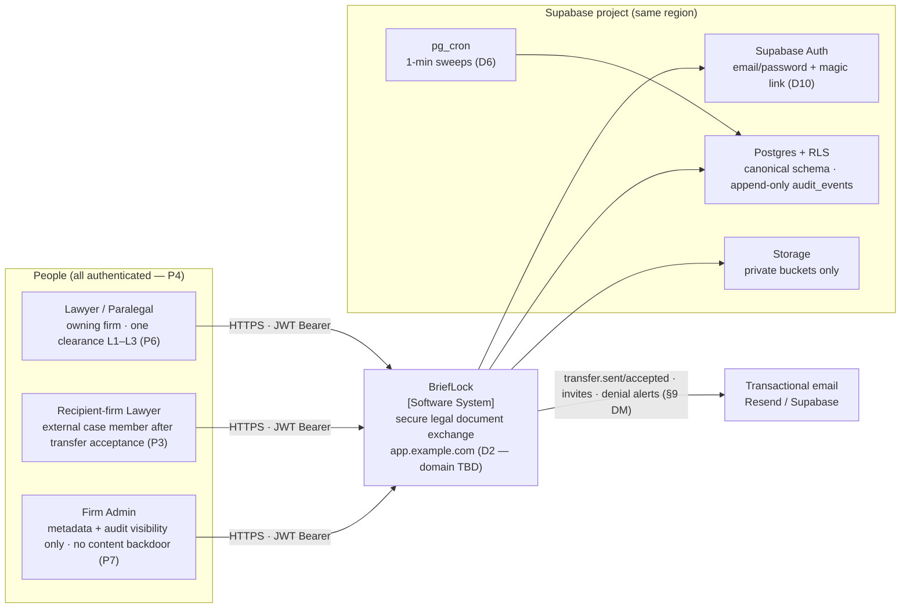
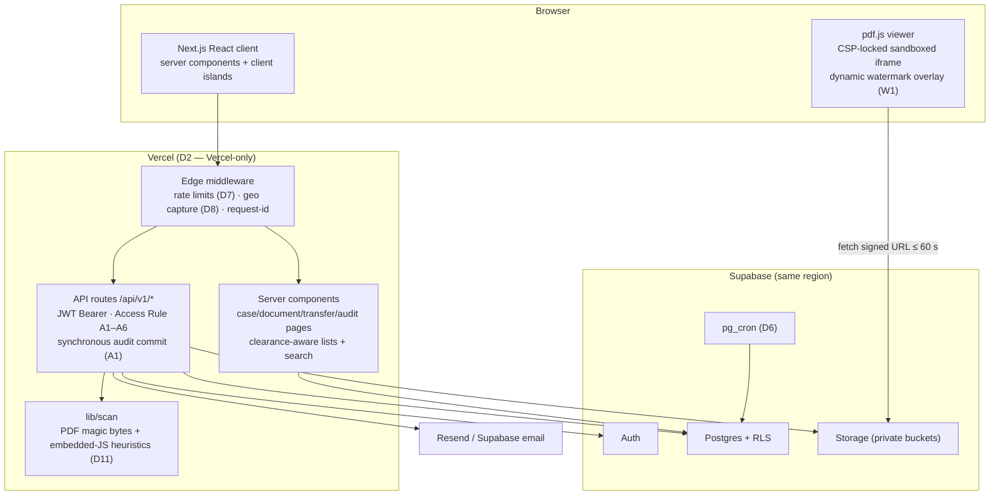
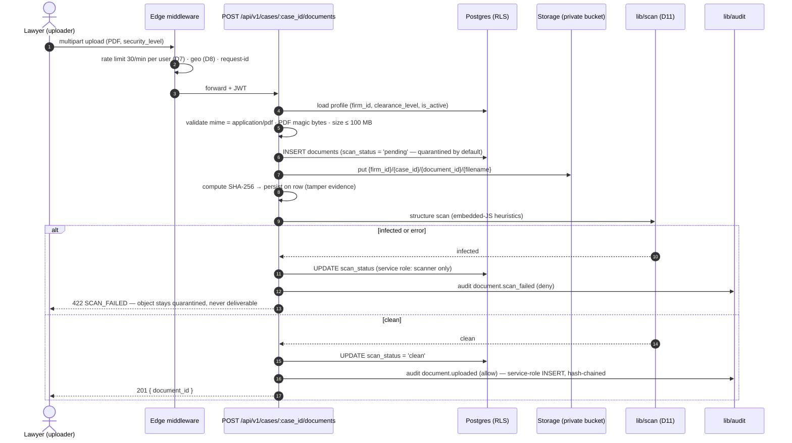
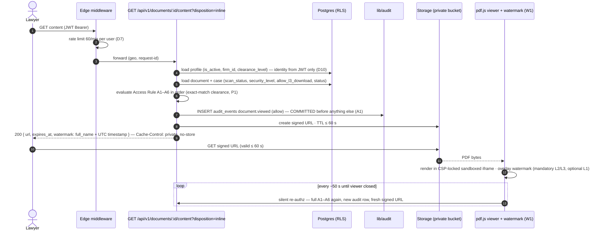
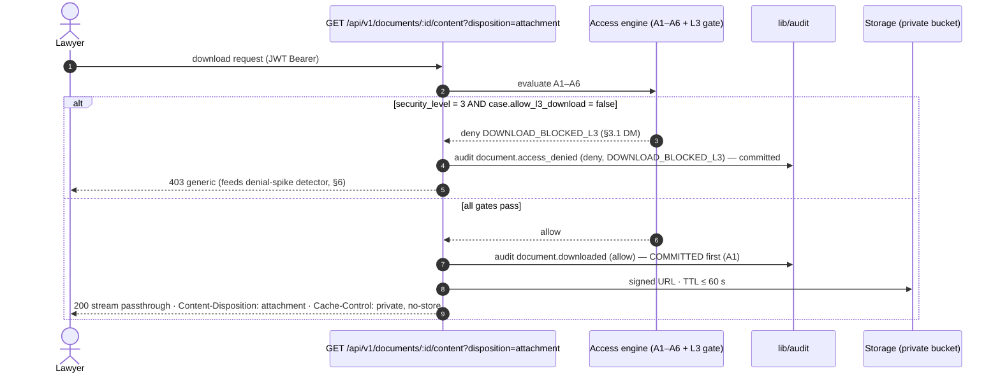
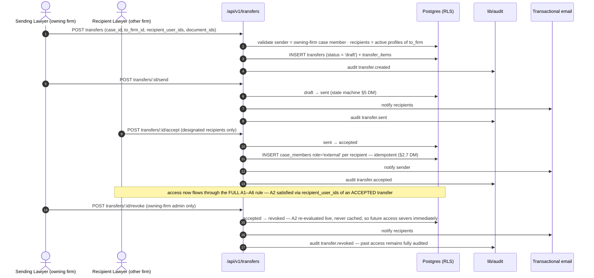
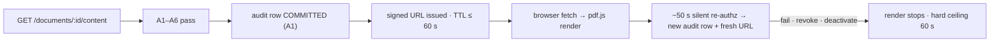
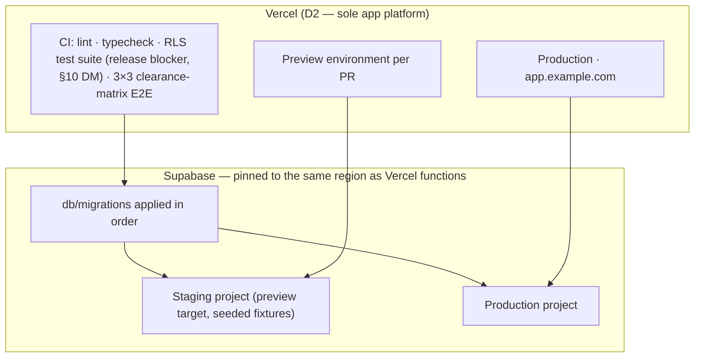

# BriefLock — Technical Architecture

**Version 2.0 — Regenerated for the legal document exchange core idea**

> **Status:** Normative for implementation. Companion to `DECISIONS.md` (locked decisions D2–D11, P/W/A/S/N/V) and `DOMAIN_MODEL.md` (entities, Access Rule A1–A6, state machines). Conflicts resolve in favor of those two files.
> **Supersedes:** `ARCHITECTURE.md` v1.0 in its entirety. v1 described an expiring-link product; that product is gone. BriefLock is a **secure legal document exchange and case-file platform for law firms**: cases, immutable PDFs with security levels L1/L2/L3, exact-diagonal clearance compartments, acceptance-gated cross-firm transfers, and an immutable hash-chained audit log. It is **not** a link shortener.

---

## 1. System context

### 1.1 System context (C4 level 1)



No other services exist in MVP: no CDN in front of content, no third-party GeoIP (D8), no third-party scanning APIs (D11), no Redis (future, §8), no public share links (P4). The pdf.js viewer is part of the BriefLock front end (see 1.2).

### 1.2 Container diagram (C4 level 2)



### 1.3 Container responsibilities

| Container | Technology | Responsibility | Locked refs |
|---|---|---|---|
| Edge middleware | Vercel Edge | Per request: rate limiting (D7), geo capture (D8), request-id; gate unauthenticated page requests to login (P4) | D7, D8 |
| Server components | Next.js App Router | Render cases, documents, transfers, audit; lists/search filter **in the query** via access predicates (no post-filtering, §8 DM) | §8 DM |
| API routes | `/api/v1/*` route handlers | All mutations + content delivery; JWT Bearer; runs Access Rule A1–A6; commits audit rows synchronously before signed URLs | D10, A1, N1 |
| `lib/scan` | Node in-function | PDF structure validation (magic bytes, embedded-JS heuristics); quarantine-until-scanned | D11 |
| Supabase Auth | Managed service | Email/password + magic link; issues JWT; roles + single clearance live in `profiles` | D10, P6 |
| Postgres + RLS | Supabase | Canonical schema (DOMAIN_MODEL §2); firm-scoped RLS as structural backstop; append-only hash-chained `audit_events` | §10 DM, A1 |
| Storage | Private buckets | Immutable PDF objects at `{firm_id}/{case_id}/{document_id}/{filename}`; signed URLs TTL ≤ 60 s | §7 DM, V1 |
| pg_cron | Supabase | 1-min sweeps: signed-URL cleanup, retention (ownership map in §6) | D6 |
| pdf.js viewer | Browser library | Watermarked in-browser render; silent re-authz before signed-URL expiry | W1, P5 |
| Email | Resend / Supabase | Transactional only: transfer.sent/accepted/rejected, invites, repeated-denial alerts | §9 DM |

---

## 2. Request flows

Every flow passes edge middleware first (canonical rate limits in DECISIONS §3; geo capture D8; request-id). Authorization always **re-reads the profile row from Postgres** — the JWT proves identity only (D10).

### 2.1 Upload → validate → scan gate → store → audit



Invariants: content immutable after store — replacement = new upload (V1); uploader may only **raise** `security_level` (P2, audited `document.level_raised`); no access while `scan_status ≠ 'clean'` (A5), no exception for admins (P7).

### 2.2 View content (watermarked render)



Invariants: the audit row is committed **before** the signed URL is issued (A1); neither the response nor the URL is cached by any CDN or browser (`private, no-store`); a revoke or deactivation takes effect at the next silent re-authz — never later than the 60 s URL ceiling.

### 2.3 Download content

Same path as §2.2 up to and including the A1–A6 evaluation; differences:



| Aspect | View (§2.2) | Download (§2.3) |
|---|---|---|
| `disposition` | `inline` | `attachment` |
| Extra gate | — | L3 per-case view-only flag (`allow_l3_download = false`) → `DOWNLOAD_BLOCKED_L3` |
| Audit action | `document.viewed` | `document.downloaded` |
| Delivery | pdf.js render | streamed attachment (no full-object buffering) |

### 2.4 Transfer: send → accept → external membership → revoke severing



`reject` (sent → rejected) and `cancel` (sent → cancelled) follow the same transition-plus-audit pattern. External members stay subject to every check — including exact-match clearance (P1) and the L3 download gate (P5).

### 2.5 Denial path

```mermaid
sequenceDiagram
    autonumber
    actor U as Caller
    participant API as any content-bearing endpoint
    participant AX as Access engine (A1–A6)
    participant AU as lib/audit
    participant AL as Denial-spike detector

    U->>API: request content
    API->>AX: evaluate A1–A6 in order
    AX-->>API: first failing check → canonical deny_reason (§3.2 DM enum)
    API->>AU: INSERT audit_events (result='deny', deny_reason, ip_hash D9, country/city) — committed
    API-->>U: 403 { error.code = ACCESS_DENIED, correlation_id }
    Note over API,U: body never reveals which check failed — blocks clearance probing; the reason lives only in audit_events
    AL->>AL: ≥ 5 denials on same profile within 15 min → email firm admin (§3.2 DM)
```

Canonical deny reasons: `UNAUTHENTICATED` · `DEACTIVATED` · `FIRM_MISMATCH` · `NOT_CASE_MEMBER` · `CLEARANCE_MISMATCH` · `UNSCANNED` · `INFECTED` · `CASE_ARCHIVED` · `DOWNLOAD_BLOCKED_L3`. `401` is reserved for missing/invalid credentials; every other failure returns the generic `403`. **Every** denial — including probes on nonexistent or cross-firm document UUIDs — writes an audit row (A1).

---

## 3. Layer & module architecture

### 3.1 Repository layout

```
brieflock/
├── app/
│   ├── (auth)/                  # login · signup · invite-accept — the ONLY public routes (P4)
│   ├── (app)/                   # authenticated shell, middleware-gated
│   │   ├── cases/               # case list/detail · members · legal-hold
│   │   ├── documents/           # metadata pages · PdfViewer page
│   │   ├── transfers/           # inbound/outbound · accept/reject UI
│   │   ├── audit/               # firm-scoped audit trail (P7)
│   │   └── admin/               # firm settings · clearance/role changes (audited)
│   └── api/v1/                  # route handlers — the only server-side mutation surface (N1)
│       ├── cases/               # CRUD · members · archive
│       ├── documents/           # POST upload · GET :id/content (view + download) · level changes
│       ├── transfers/           # create · send · accept · reject · cancel · revoke
│       ├── search/              # clearance-aware search (§8 DM)
│       ├── audit/               # firm-scoped read · NDJSON export
│       ├── jobs/                # CRON_SECRET-protected job endpoints (§6)
│       └── health.ts            # GET /api/v1/health (N1)
├── lib/
│   ├── access/                  # THE A1–A6 engine — single code path (ADR-2)
│   ├── audit/                   # hash-chain writer + verifier · service-role INSERT only (A1)
│   ├── storage/                 # path builder · signed URLs ≤ 60 s · stream passthrough
│   ├── ratelimit/               # RateLimiter interface · in-memory token bucket (D7)
│   ├── scan/                    # magic bytes + embedded-JS heuristics (D11)
│   ├── geo/                     # request.geo capture · salted ip_hash (D8, D9)
│   ├── email/                   # transactional templates (transfer · invite · denial alerts)
│   └── errors/                  # error envelope + correlation ids (§7)
├── db/migrations/               # SQL schema · RLS policies · audit triggers
├── components/                  # UI incl. PdfViewer (sandboxed iframe + watermark overlay, W1)
└── proxy.ts                    # edge: rate limit · geo · request-id (§4)
```

### 3.2 Module responsibilities

| Module | Owns | Must not |
|---|---|---|
| `lib/access` | Evaluate A1–A6; expose (a) point check `assertAccess()` for content routes and (b) SQL predicate builder for lists/search, so filtering happens **in the query** (§8 DM) | Trust JWT claims for clearance/firm/role; return per-check reasons to clients |
| `lib/audit` | Canonical event builder; hash chain `entry_hash = SHA256(prev_hash ‖ canonical_event)`, genesis `prev_hash` = 64 zeros (A1); service-role insert; chain verifier; NDJSON export | Expose any UPDATE/DELETE path; log raw IPs (D9) |
| `lib/storage` | `{firm_id}/{case_id}/{document_id}/{filename}` paths; signed URLs TTL ≤ 60 s; stream passthrough; `private, no-store` headers | Public buckets; issue any URL before the audit row is committed (A1) |
| `lib/ratelimit` | `RateLimiter` interface + in-memory per-instance token bucket; canonical limits (DECISIONS §3) | Limit before identity resolution where limits are per-user |
| `lib/scan` | Quarantine-until-scanned lifecycle `pending → clean / infected / error` | Call third-party scanning APIs — ever (D11) |
| `lib/geo` | Vercel geo header capture; salted SHA-256 `ip_hash` at ingest | Persist raw IPs — anywhere, ever (D9) |
| `app/api/v1` | Orchestration only: parse → authorize → act → audit → respond | Contain business rules (they live in `lib/*`) |

### 3.3 One access engine, two outputs

Both surfaces compile from the same A1–A6 rule table:

- `assertAccess(profile, document, case_row, action)` → `allow | deny(reason)` — content view/download routes (§2.2–§2.3).
- `accessibleDocumentsQuery(profile, filters)` → SQL predicate — case/document lists and `/search`, so inaccessible rows are structurally excluded and titles, counts, and existence of inaccessible items never leak (§8 DM).

The 3×3 clearance matrix (DOMAIN_MODEL §3.3, diagonal-only) is therefore enforced exactly once and exercised by the E2E matrix suite (MVP success criteria).

---

## 4. Enforcement placement

| Layer | Enforces | Deliberately does NOT |
|---|---|---|
| Edge middleware | Rate limits (D7): in-memory token bucket behind `RateLimiter` interface — auth 10/min per IP · upload 30/min per user · content 60/min per user · other `/api/v1/*` 100/min per user · `429` + `Retry-After` (DECISIONS §3). Geo capture (D8) via `request.geo`. Request-id mint/propagate. Redirect unauthenticated page requests to login (P4) | Authorization decisions of any kind; no JWT claim trusted for clearance; no DB access |
| API routes / server components | All authorization: profile re-read from DB each request — JWT carries identity only (D10). Access Rule A1–A6 on every content access. L3 download gate (§3.1 DM). Level-change role rules (P2) | Accept client-supplied `security_level`/`clearance_level`; provide any admin backdoor (P7) |
| Postgres RLS | Structural backstop (DOMAIN_MODEL §10): every table firm-scoped; cross-firm rows invisible through lists, search, counts, and error messages; `audit_events` has no UPDATE/DELETE policies for any role (A1) | Act as the primary authz engine — the app rule is authoritative; RLS is defense-in-depth |
| Service role | ONLY: scanner `scan_status` transitions · transfer state transitions · audit ingest · pg_cron sweeps | Handle user requests; read content on any user's behalf |

The automated RLS test suite proving the §10 invariant is a release blocker (DOMAIN_MODEL §10; DECISIONS §5).

---

## 5. Data flow between tiers

### 5.1 Signed URL lifecycle



Rules:

- No CDN caching anywhere in MVP: content responses and the signed-URL response carry `Cache-Control: private, no-store`; signed URLs are single-purpose (`inline` render vs `attachment` download).
- File streaming: the API proxies Storage bytes as a stream (passthrough, no full-object buffering); the 100 MB cap is enforced at validation, so serverless memory stays flat.
- Document bytes reach the client only via a signed URL issued after a committed audit row (A1) — no previews, thumbnails, or side channels in MVP.
- Emails carry no content links — only in-app pointers (P4: no public document pages).

---

## 6. Background jobs

| Job | Owner | Cadence | Purpose | Protection |
|---|---|---|---|---|
| Signed-URL cleanup | pg_cron (D6) | 1 min | Expire/revoke stale storage signatures (belt-and-braces; TTL ≤ 60 s already bounds exposure) | in-database |
| Retention sweeps | pg_cron (D6) | 1 min | Apply `firms.settings` retention / `cases.retention_days`; skip `legal_hold = true` cases | in-database |
| Hash-chain verify | App-scheduled: Vercel cron → `/api/v1/jobs/verify-chain` | 5 min | Recompute `entry_hash` chain from genesis (64 zeros); alert on any break (A1) | `CRON_SECRET` |
| Denial-spike alerts | App-scheduled: Vercel cron → `/api/v1/jobs/denial-alerts` | 1 min | ≥ 5 denials on same profile within 15 min → email firm admin (§3.2 DM) | `CRON_SECRET` |
| Audit NDJSON export | App-scheduled: Vercel cron → `/api/v1/jobs/audit-export` | daily | NDJSON cold archive of `audit_events` (append-only, retained indefinitely, §2.8 DM) | `CRON_SECRET` |

Ownership rule: pure SQL over Supabase data → pg_cron (D6); anything needing email, hashing over large datasets, or outbound calls → app-scheduled endpoints guarded by `CRON_SECRET`. Enforcement never depends on cron success — lazy read-time checks (A1–A6 on every request) remain the real enforcer (D6). Job endpoints are no-ops without the secret and sit outside the user rate-limit classes.

---

## 7. Cross-cutting concerns

### 7.1 Error envelope + correlation ids

Every non-2xx response:

```json
{ "error": { "code": "ACCESS_DENIED", "message": "Request denied.", "correlation_id": "req_…" } }
```

| `error.code` | HTTP | When |
|---|---|---|
| `VALIDATION_FAILED` | 422 | Malformed input; failed PDF validation (magic bytes / size); `SCAN_FAILED` detail |
| `UNAUTHENTICATED` | 401 | Missing/invalid credentials — the only place A1's reason surfaces to the client |
| `ACCESS_DENIED` | 403 | Any A2–A6 or L3-gate failure — generic body; the specific `deny_reason` exists only in `audit_events` (§2.5) |
| `NOT_FOUND` | 404 | Unknown **and** cross-firm objects alike — masks existence (§10 DM) |
| `RATE_LIMITED` | 429 | Canonical limits; includes `Retry-After` (D7) |
| `INTERNAL` | 500 | Unexpected; `correlation_id` links to logs |

Middleware mints `req_…` (or honors inbound `X-Request-Id`), attaches it to logs, audit `details`, and the error envelope.

### 7.2 Structured logging + observability

- JSON log lines via Vercel → LogTail drain: `correlation_id`, user id, action, result, latency. IP fields: `ip_hash` (salted SHA-256, D9) + country/city only — **raw IPs never persisted** anywhere.
- Sentry: server + viewer exceptions.
- SLO alerts (S1, p95): signed-URL issuance < 100 ms **including the synchronous audit commit** · API < 200 ms · dashboard initial load < 2 s · uptime 99.9%.

### 7.3 Configuration / environment inventory

| Var | Scope | Purpose |
|---|---|---|
| `NEXT_PUBLIC_APP_URL` | build | `https://app.example.com` (D2 placeholder — domain TBD) |
| `SUPABASE_URL` / `SUPABASE_ANON_KEY` | server + client | anon client; RLS applies to every query |
| `SUPABASE_SERVICE_ROLE_KEY` | server only | scanner · transfer transitions · audit ingest ONLY (§4) |
| `SUPABASE_JWT_SECRET` | server | verify Bearer tokens (D10) |
| `IP_HASH_SALT` | server | salt for `ip_hash` (D9); rotation breaks old hashes — documented tradeoff |
| `CRON_SECRET` | server | protects `/api/v1/jobs/*` (D6) |
| `RESEND_API_KEY` | server | transactional email (or Supabase built-in SMTP) |
| `SENTRY_DSN` / `LOGTAIL_TOKEN` | server | observability hooks (§7.2) |
| `SIGNED_URL_TTL_SECONDS` | server | default 60 · hard cap 60 |

---

## 8. Deployment topology & scaling path



- **Topology (D2):** app + API + edge middleware on Vercel only; one Supabase project per environment in the same region; domain TBD → `app.example.com` placeholders throughout.
- **Preview envs:** every PR gets a Vercel preview wired to the staging Supabase project with isolated keys and seeded fixtures (incl. RLS test data).
- **Migration flow:** SQL in `db/migrations` → CI applies to staging and runs the RLS suite + clearance-matrix E2E → review gate → production apply. RLS suite green is a **release blocker** (DOMAIN_MODEL §10).
- **Scaling path (in order):**
  1. **Upstash Redis** swaps in behind the existing `RateLimiter` interface when per-instance in-memory limits (D7) stop being globally accurate — zero call-site changes.
  2. **ClamAV sidecar/container** (D11) for full AV — the **sole future non-Vercel piece** — plugged into the same quarantine-until-scanned states (`scan_method: magic-bytes-mvp → clamav`).
  3. Nothing else leaves Vercel; no CDN, no service mesh, no extra vendors.

---

## 9. Decision log (ADR-style)

| Ref | Decision | Architectural consequence in this document |
|---|---|---|
| D2 | Vercel-only deployment | §1.2, §8: single app platform; no CDN; `app.example.com` placeholders until the domain is chosen |
| D6 | pg_cron 1-min sweeps + lazy read-time checks | §6 job ownership split; `CRON_SECRET`; enforcement never depends on cron success |
| D7 | In-memory token bucket behind interface | §3.2 `lib/ratelimit`; per-instance accuracy accepted in MVP; Upstash swap-in path (§8) |
| D8 | Vercel `request.geo` | §1.2 middleware capture; no GeoIP vendor; stored as country/city only |
| D9 | IP privacy | §3.2 `lib/geo`; salted `ip_hash` at ingest; raw IPs never persisted in logs, DB, or audit rows |
| D10 | Supabase Auth, no custom auth endpoints | §4: JWT = identity only; clearance/firm/role re-read from DB every request; `/api/v1` has no auth-mutation routes |
| D11 | In-function PDF validation + quarantine | §2.1, §3.2 `lib/scan`; `scan_status` gates all access (A5); ClamAV container = sole future non-Vercel piece (§8) |
| P1 | Exact-match clearance compartments | §3.3 diagonal-only matrix in `lib/access`; hierarchical mode is a future toggle, not built |
| P2 | Raise by uploader · lower by admin only | §3.1 level-change routes branch on role; both audited (`document.level_raised` / `document.level_lowered`) |
| P3 | One-way acceptance-gated transfers | §2.4 state machine; `external` membership inserted on accept; revoke severs A2 live |
| P4 | Authenticated app only | §3.1 `(auth)` routes are the only public surface; secure share links = fast-follow reusing signed-URL machinery |
| P5 | L3 per-case view-only flag | §2.3 `allow_l3_download` gate; denial logged as `DOWNLOAD_BLOCKED_L3` |
| P6 | One clearance per user | `profiles.clearance_level` single int; no clearance sets anywhere in the model |
| P7 | No admin backdoor | Admin surfaces read metadata/audit only; the content path is identical for admins (A1–A6) |
| P8 | Security baseline + GDPR-aligned | Processor posture; `legal_hold` respected by retention sweeps (§6); DPA/retention in `firms.settings` |
| W1 | Dynamic watermark | §2.2 viewer overlay (full name + UTC timestamp), mandatory L2/L3; watermark params issued with the signed-URL response |
| A1 | Immutable hash-chained audit, sync-before-URL | §3.2 `lib/audit` service-role insert; commit awaited before signed URL (§2.2, §5.1); verifier job (§6) |
| S1 | SLOs (p95) | §7.2 alert thresholds; latency budgets include the synchronous audit commit |
| N1 | Naming contract | `document` / `security_level` / `clearance_level` / `transfer` / `audit_event` everywhere; `/api/v1` prefix; UUID paths; `GET /api/v1/health` |
| V1 | Document immutability | No edit/in-place versioning routes exist (§3.1); replacement = new upload; `superseded` flag |
| ADR-1 | Signed URL TTL ≤ 60 s + `private, no-store` | §5.1 exposure bounded; silent re-authz loop keeps long reading sessions usable (§2.2) |
| ADR-2 | Single A1–A6 engine reused as query predicates | §3.3 lists/search cannot drift from content authz; no existence leaks via counts/titles (§8 DM) |
| ADR-3 | Generic 403 denial surface | §2.5 `deny_reason` visible only in `audit_events`; blocks clearance probing |
| ADR-4 | RLS as structural backstop, app rule authoritative | §4 two independent enforcement layers; RLS test suite = release blocker (§10 DM) |
