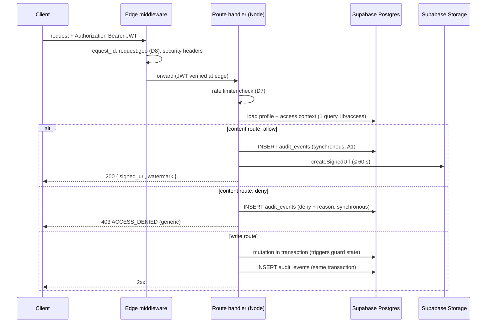

# BriefLock — Backend Architecture

**Version 2.0 — Regenerated for the legal document exchange core idea**

| Field | Value |
|---|---|
| **Status** | Draft for implementation |
| **Supersedes** | Backend Architecture v0.1 (v1 product: link CRUD, redirect worker, click ingestion, TTL locks) — archived in `docs-v1-archive/` |
| **Contract** | `DECISIONS.md` (🔒) + `DOMAIN_MODEL.md` (🔒) govern. API surface = `API_SPEC.md` §2. Schema = `DATABASE_SCHEMA.md`. |
| **Runtime** | Vercel serverless (Next.js 16 route handlers) — **Vercel-only** (D2); no side services |
| **Golden rules** | One access-control engine (`lib/access`) used by every route; audit rows are committed **synchronously before** signed URLs (A1); client bytes never traverse the API; everything auditable within 1 s |

---

## 0. Executive Summary

BriefLock's backend is a thin, strictly-ordered pipeline over the `/api/v1` routes: **authenticate → rate-limit → resolve access context → decide → audit → act**. There is no business logic outside that pipeline. The single most important component is `lib/access`, the only implementation of the access rule (DOMAIN_MODEL §3) — RLS provides storage-layer defense, but the API enforces the rule explicitly so denials can be audited with precise `deny_reason` values that the storage layer alone cannot emit. Cross-firm exchange runs through the transfer state machine with an idempotent external-membership insert; content delivery is stateless signed-URL issuance gated on a committed audit row.

## 1. Runtime & Request Lifecycle



| Concern | Decision |
|---|---|
| Middleware | `proxy.ts`: verifies JWT signature (JWKS cache), sets `x-request-id`, reads Vercel geo headers (D8) into the request context, adds security headers (CSP per FRONTEND_ARCH). Does **not** do authorization. |
| Runtime | Node.js runtime for all `/api/v1` routes (pg client + `digest()` needs); edge only for header work |
| Timeouts | Route-level `maxDuration` 15 s (upload-complete streams from storage — D11 — may use 30 s) |
| Correlation | `request_id` (uuid) returned in the error envelope and attached to every log line and Sentry event |
| Observability | Sentry (exceptions, p95 spans per route) + LogTail (structured JSON logs); SLO metrics per S1: signed-URL p95 < 100 ms incl. audit commit, API p95 < 200 ms |

## 2. Module Map

```
src/lib/
  access.ts        # the ONLY access-rule implementation (§3) — no route re-derives access
  audit.ts         # synchronous, transactional audit writes (§4)
  scan.ts          # D11 in-function PDF structure validation (§5)
  storage.ts       # private bucket: signed upload URLs, signed read URLs (§6)
  transfers.ts     # transfer state machine service (§7)
  ratelimit.ts     # RateLimiter interface + in-memory token bucket (D7) (§8)
  auth.ts          # Supabase Auth server client; DB re-read of role/clearance (§9)
  errors.ts        # error envelope + deny mapping (§10)
  geo.ts           # Vercel geo header parsing (D8) + ip_hash (D9)
  env.ts           # typed env validation (§12)
supabase/          # migrations, RLS suite (DATABASE_SCHEMA §6)
tests/             # Vitest unit · integration · Playwright E2E · k6 (TESTING_STRATEGY)
```

| Module rule | Detail |
|---|---|
| Single engine | Any new route that touches documents/cases/transfers **must** go through `access.ts`; grep-enforced in review (a route importing `documents` directly without `access.ts` is a PR blocker) |
| No cross-module bypass | `storage.ts` refuses to mint a read URL without an `access.ts` decision token passed by the caller |
| Fail-closed | Any exception inside the pipeline → `500 INTERNAL`, no partial success responses; content routes never emit URLs on error paths |

## 3. Access-Control Engine — `lib/access.ts`

The single implementation of DOMAIN_MODEL §3. Every route that resolves a document/case/transfer passes through here; RLS (DATABASE_SCHEMA §6) is the second, independent line of defense.

```ts
type Decision = { allow: true; ctx: AccessContext } | { allow: false; reason: DenyReason };

export async function decideDocumentAccess(
  supabase: SupabaseClient,          // service role, server-side
  userId: string,
  documentId: string,
  intent: 'view' | 'download' | 'metadata',
): Promise<Decision>
```

Evaluation order (first failure wins — deterministic, unit-tested):

| Step | Check (DOMAIN_MODEL §3) | Deny reason |
|---|---|---|
| 1 | Profile exists, `is_active = true` | `UNAUTHENTICATED` / `DEACTIVATED` |
| 2 | Context load (single query below) — document/case unknown | route answers `404` (no audit row) |
| 3 | `profile.firm_id = document.firm_id` ∨ accepted-transfer grant | `FIRM_MISMATCH` |
| 4 | `case_members` row exists for `(case, user)` | `NOT_CASE_MEMBER` |
| 5 | `clearance_level = security_level` (diagonal, §3.3) | `CLEARANCE_MISMATCH` |
| 6 | `scan_status = 'clean'` | `UNSCANNED` / `INFECTED` |
| 7 | `intent = 'download'` ∧ L3 ∧ `case.allow_l3_download = false` | `DOWNLOAD_BLOCKED_L3` (distinct code, view unaffected) |
| 8 | `intent = write` ∧ `case.status = 'archived'` | `CASE_ARCHIVED` |

**Context load** — one query, no N+1: `documents ⋈ cases ⋈ profiles ⋈ case_members` + `exists (select 1 from transfers t join transfer_items ti … where t.status='accepted' and t.recipient_user_ids @> array[user_id] and ti.document_id = …)`. The predicate mirrors `can_see_document()` exactly; an integration test asserts both return identical verdicts over a seeded 3×3 matrix (TESTING_STRATEGY §unit).

**Firm-admin exception (P7)**: `intent = 'metadata'` allows step 3 to pass on `firm_id` match with `role='firm_admin'` — steps 4–6 still apply for content; admins never bypass content checks. Admin metadata responses carry no content fields.

**Decision token**: on `allow`, the engine returns an HMAC-signed, 10 s-valid token `{documentId, intent, userId, iat}` which `storage.ts` requires before minting any URL — enforcing the "no URL without a decision" rule (§2).

## 4. Audit Service — `lib/audit.ts`

```ts
export async function audit(
  tx: Transaction,                       // same tx as the mutation, or its own for content routes
  e: { actorUserId?: string, firmId?: string, caseId?: string, documentId?: string,
       transferId?: string, action: AuditAction, result: 'allow'|'deny'|'info',
       denyReason?: DenyReason, req: Request, details?: Json },
): Promise<void>
```

| Rule | Detail |
|---|---|
| Synchronous | Always awaited inside the request — never a fire-and-forget queue (A1: "auditable within 1 s") |
| Before-URL | For content routes the audit `INSERT` is **committed before** `storage.createSignedUrl` is called; the route has no code path that mints a URL first (enforced by `storage.ts` decision-token check) |
| Write routes | Audit row joins the mutation transaction — a rolled-back mutation leaves no orphan event |
| Chain integrity | `prev_hash`/`entry_hash` computed by `trg_audit_chain` (DATABASE_SCHEMA §5); app code never sets them |
| Privacy | `ip_hash = SHA256(env.IP_SALT ‖ ip)` (D9 — raw IP never persisted); `country`/`city` from Vercel geo (D8); `user_agent` truncated to 200 |
| Denials | Every A1–A6 failure logs `document.access_denied` (`result='deny'`, exact reason) — before the generic 403 is sent |

**Route → action map** (the only legal 23 values, DOMAIN_MODEL §6): auth failures → `auth.login_failed` (platform, `firm_id = null`) · member/firm admin ops → `member.*` / `clearance.changed` / `firm.updated` · case lifecycle → `case.*` · uploads/scans → `document.uploaded` / `document.scan_failed` · content → `document.viewed` / `document.downloaded` / `document.access_denied` · level ops → `document.level_raised` / `document.level_lowered` · transfers → `transfer.*`. New values require a contract amendment, never a local string.

**Repeated-denial alert**: after committing a deny row, count denials for the actor in the last 15 min; ≥ 5 → transactional email to firm admins (rate-limited to 1 email/hour/profile, DOMAIN_MODEL §3).

## 5. Scanning Pipeline — `lib/scan.ts` (D11)

```
upload-intent → client PUTs bytes to private bucket → complete → verifyObject()
  ├─ size check (≤ 100 MB, matches metadata)
  ├─ magic bytes: header starts '%PDF-'; trailing '%%EOF' present
  ├─ structure heuristics (raw byte scan): /JavaScript, /JS, /OpenAction, /Launch,
  │   /EmbeddedFile, /RichMedia → infected
  ├─ sha256 computed (streaming) → stored
  └─ scan_status := clean | infected | error   (error = unreadable/failure ⇒ quarantined too)
```

| Rule | Detail |
|---|---|
| In-function only | Vercel-only (D2) ⇒ no sidecar; the whole PDF streams through one function with `maxDuration` 30 s |
| Quarantine | Any state ≠ `clean` blocks all access (A5). Rows are kept — admins see the failure in the document list (`Infected`/`Error`) and audit (`document.scan_failed`) |
| No third parties | Client files are **never** sent to external scanning APIs (D11). ClamAV container = fast-follow, documented as the only future non-Vercel infra piece; `scan_method` flips `magic-bytes-mvp` → `clamav` |
| Probe safety | Scanning runs on the stored object, not on client-submitted bytes in memory |
| Budget | p95 scan of a 10 MB PDF < 5 s; the UI shows the pending state (UI_UX §3.6) — scan time is excluded from the API SLO but included in the "upload → first view < 60 s" success criterion |

## 6. Content Delivery — `lib/storage.ts`

| Operation | Behavior |
|---|---|
| `createUploadIntent(firmId, caseId, documentId, filename)` | Returns a **one-time** signed `PUT` URL for the private bucket, TTL 300 s, `content-type: application/pdf`; path `{firm_id}/{case_id}/{document_id}/{filename}`. No public bucket exists (DATABASE_SCHEMA §8). |
| `issueReadUrl(decisionToken, disposition)` | Verifies the HMAC token from `lib/access` (§3) → `createSignedUrl` with **TTL ≤ 60 s** → returns `{signed_url, expires_at, watermark}`. Requires that the `document.viewed`/`downloaded` audit row was already committed by the caller (A1). |
| Headers | `Cache-Control: no-store` on every API response carrying a URL; signed URLs are never logged in plaintext (Sentry scrubbing) |
| Client contract | Viewer silently re-requests ~10 s before expiry (UI_UX §3.7); a 403 on refresh renders the uniform interstitial |
| Object deletion | Only via `retention_sweep()` (service role, legal-hold aware) — never a user-facing route (V1) |

## 7. Transfer Machine — `lib/transfers.ts`

```ts
export async function transition(
  transferId: string, action: 'send'|'accept'|'reject'|'cancel'|'revoke', actor: Profile,
): Promise<Transfer>
```

- Validates **actor** per API_SPEC §7.3 (send/cancel: owning-firm case member; accept/reject: `actor.id ∈ recipient_user_ids` ∧ status `sent`; revoke: owning-firm admin ∧ status `accepted`) — wrong actor → `403 FORBIDDEN`, illegal state → `409 CONFLICT` (trigger backstop: `trg_transfer_guard`).
- Runs in one transaction: `UPDATE transfers` + `audit_events` row (§4) +, on **accept**, idempotent insert of each designated recipient into `case_members (role='external')` — `on conflict (case_id, user_id) do nothing`.
- **Revoke** removes the external memberships created by this transfer, then re-inserts memberships still granted by *other* accepted transfers for the same recipients (edge: two overlapping transfers) — recipients lose only what this transfer granted. Past access stays fully audited (DOMAIN_MODEL §5).
- Emails (`transfer.sent` → recipients; outcome → sender) are queued **after commit**; email failure never rolls back the accepted state — the audit trail is the source of truth.

## 8. Rate Limiting — `lib/ratelimit.ts` (D7)

| Aspect | Decision |
|---|---|
| MVP implementation | In-memory per-instance token bucket (per lambda isolate) — good enough at MVP traffic; **not** a correctness boundary |
| Interface | `RateLimiter { check(key: string, limit: RateClass): Result }` with an `UpstashRedisLimiter` behind the same interface for the fast-follow (D7 requires the seam) |
| Classes | `auth` 10/min per IP (invite-accept; Supabase Auth guards its own endpoints) · `upload` 30/min per user · `content` 60/min per user · `standard` 100/min per user (DECISIONS §3) |
| Keys | `class:user:{id}` / `class:ip:{ip_hash}` — hashed keys only |
| On exceed | `429 RATE_LIMITED` + integer `Retry-After` (seconds); the attempt is **not** audited as a denial (it never reached the access rule) |
| Consistency | Buckets reset per instance deploy; the SLO budget absorbs the approximation. The content class is also capped upstream at the edge to blunt bursts |

## 9. Auth Integration — `lib/auth.ts` (D10)

- Supabase Auth (email+password, magic link) owns **all** credentials; this API has no auth endpoints.
- `proxy.ts` verifies the JWT (JWKS, cached 1 h); route handlers re-resolve the **profile row** on every request — `role`, `clearance_level`, `is_active` come from the DB, never from token claims (a deactivated user fails A1 on their very next request).
- Service-role client is used **only** inside route handlers; the anon key never reaches the browser.
- Failed logins surface to the platform as `auth.login_failed` audit rows (`firm_id = null`, visible to operators only — RLS hides them from firm admins).

## 10. Errors & Observability

- One error envelope (`API_SPEC` §1.2), one mapper in `errors.ts`: `DenyReason → 403` (with the `DOWNLOAD_BLOCKED_L3`/`CASE_ARCHIVED` carve-outs), `ZodError → 400` field map, pg unique violation → `409`, everything else → `500 INTERNAL` + Sentry.
- Structured logs: `{request_id, route, actor_user_id?, decision?, latency_ms}` — **scrubbed** of filenames, signed URLs, emails-at-rest beyond firm id, and raw IPs (D9).
- Sentry spans wrap: access-context load, audit commit, signed-URL mint — the audit-commit span is the one S1's "signed-URL p95 < 100 ms incl. audit commit" is measured on.
- Alerting: 5xx rate, SLO breach (S1), `audit_chain_verify` mismatch (§11), repeated-denial banner feed.

## 11. Background Work (D6)

| Job | Trigger | Work |
|---|---|---|
| `retention-sweep` | pg_cron every 1 min | `retention_sweep()` (DATABASE_SCHEMA §10) — legal-hold aware, service role |
| `audit-verify` | daily + on-demand | `audit_chain_verify()`; any mismatch pages ops (chain integrity is release-blocking) |
| `invite-expiry` | hourly | purge expired, unaccepted invites |
| HTTP route variant | `GET /api/cron/{job}` with `Authorization: Bearer $CRON_SECRET` | identical functions; secret-checked in middleware; **not** under `/api/v1` and never exposed to clients |
| Lazy enforcement | every request | Read-time checks (archived cases, retention on access, deactivation) are the real gate — cron only sweeps (D6) |

## 12. Configuration

| Env var | Used by | Notes |
|---|---|---|
| `NEXT_PUBLIC_SUPABASE_URL` / `SUPABASE_SERVICE_ROLE_KEY` | all routes | service role server-only |
| `SUPABASE_JWT_SECRET` (or JWKS URL) | middleware | token verification |
| `IP_SALT` | `lib/geo.ts` | D9 salted hash; rotate = all `ip_hash` values churn (acceptable; documented) |
| `CRON_SECRET` | §11 | D6 |
| `ACCESS_TOKEN_HMAC` | `lib/access` → `lib/storage` | decision-token signing |
| `SENTRY_DSN`, `LOGTAIL_TOKEN` | observability | — |
| `RESEND_API_KEY` | transactional email | DOMAIN_MODEL §9 |

Vercel-only (D2): no other platform config exists; `app.example.com` placeholders until the domain is named.

## 13. Backend Test Hooks (for TESTING_STRATEGY)

- `lib/access` is exported pure over an injected context loader → the 3×3 matrix is a table-driven unit suite (9 cells + admin/transfer/archived variants).
- `lib/scan` runs on fixture PDFs (clean, JS-laden, truncated, oversized) in CI without network.
- A test-only `StorageFake` implements the same decision-token gate, proving "no URL without audit" by construction.
- Every route handler contract test asserts: audit row count, envelope shape, and the no-leak rule (§10 of API_SPEC).

## Changelog

| Version | Change |
|---|---|
| 2.0 | Regenerated for the legal document exchange core idea: single access engine, synchronous audit-before-URL, D11 in-function scanning + quarantine, signed-URL delivery ≤ 60 s, transfer machine with idempotent external membership, D7 limiter seam, D6 cron. Removed link/click/TTL backend. |
| 0.1 | Initial draft (v1 product — retired). |
