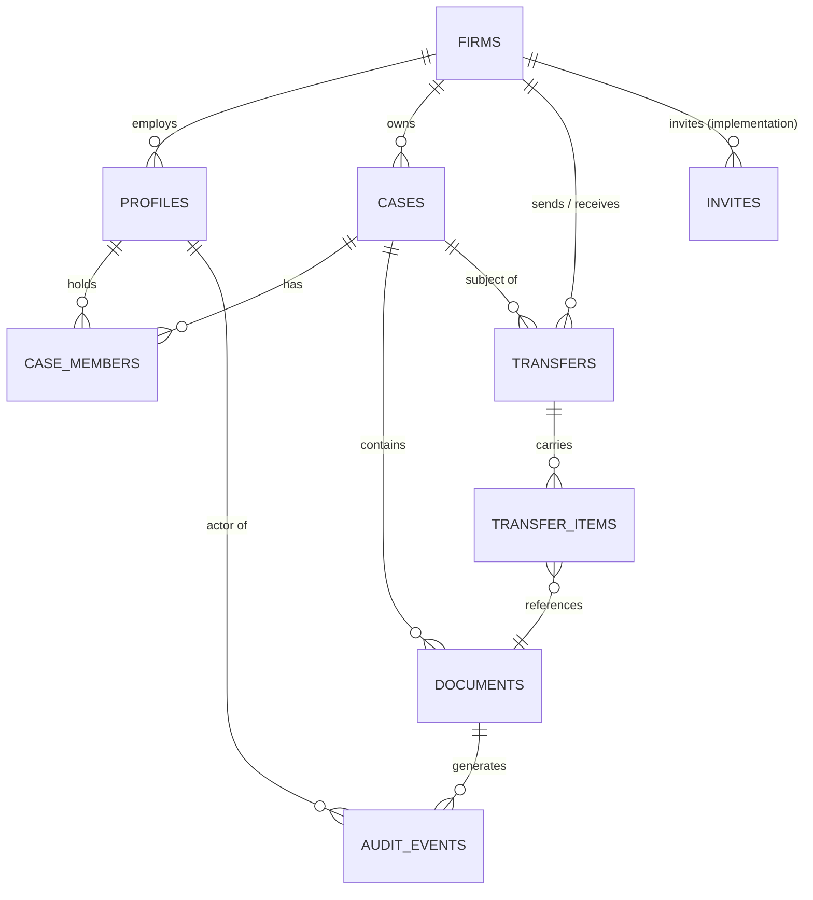

# BriefLock — Database Schema Design

**Version 2.0 — Regenerated for the legal document exchange core idea**

| Field | Value |
|---|---|
| **Status** | Draft for implementation |
| **Supersedes** | Schema v0.1 (v1 product: `links`, `clicks`, TTL/lock fields) — archived in `docs-v1-archive/` |
| **Contract** | `DOMAIN_MODEL.md` (🔒 §1–§10) defines every entity, check constraint, and state machine **verbatim**; `DECISIONS.md` (🔒) sets infra policy. Conflicts resolve in their favor — this document adds implementation detail only. |
| **Database** | Supabase PostgreSQL (pg_cron enabled, D6) |
| **Auth store** | Supabase `auth.users` (D10) — extended by `profiles`, never modified |
| **Tooling** | Migrations via Supabase CLI (`supabase/migrations/NNNN_*.sql`), applied through GitHub Actions |
| **Golden rule** | RLS suite ships **with migration 0001**; a schema without its policies is not a valid migration (cross-firm invisibility is a release blocker, DOMAIN_MODEL §10) |

---

## 1. Conventions

| Convention | Rule |
|---|---|
| Primary keys | `id uuid primary key default gen_random_uuid()` (N1: no guessable sequential IDs exposed by the API) |
| Timestamps | `timestamptz` default `now()`, UTC; suffixes `_at` |
| Case-insensitive text | `citext` for emails and firm slugs |
| Enums | `text` + named `CHECK` constraints (per DOMAIN_MODEL); new values = additive migration |
| Multi-tenancy | Every table carries `firm_id` or resolves to one via parent (DOMAIN_MODEL §10) — verified by the RLS suite |
| Deletes | **No hard deletes** except `invites` (revocation) and retention-purged documents (§11). People/cases end via `is_active`/`deactivated_at`/`status` |
| `updated_at` | Maintained by trigger `set_updated_at()` on mutable tables |
| Immutability | `documents` content is immutable (V1) — **no `UPDATE` policy** for client roles; `audit_events` is append-only (A1) |
| Naming | `snake_case`; singular table names; no reserved words |

## 2. Extensions

```sql
create extension if not exists pgcrypto;   -- digest() for SHA-256 (hash chain, ip_hash)
create extension if not exists citext;     -- emails, slugs
create extension if not exists pg_cron;    -- scheduled sweeps (D6)
```

## 3. Enumerated Values (as CHECK constraints)

| Column | Values |
|---|---|
| `profiles.role` | `firm_admin` \| `lawyer` \| `paralegal` |
| `profiles.clearance_level` | `1` \| `2` \| `3` (exactly one per user — P6) |
| `cases.default_security_level` / `documents.security_level` | `1` \| `2` \| `3` |
| `cases.status` | `open` \| `closed` \| `archived` (default `open`) |
| `case_members.role` | `lead` \| `member` \| `external` (default `member`) |
| `documents.scan_status` | `pending` \| `clean` \| `infected` \| `error` (default `pending`) |
| `transfers.status` | `draft` \| `sent` \| `accepted` \| `rejected` \| `cancelled` \| `revoked` (default `draft`) |
| `audit_events.result` | `allow` \| `deny` \| `info` |
| `audit_events.deny_reason` | `UNAUTHENTICATED` · `DEACTIVATED` · `FIRM_MISMATCH` · `NOT_CASE_MEMBER` · `CLEARANCE_MISMATCH` · `UNSCANNED` · `INFECTED` · `CASE_ARCHIVED` · `DOWNLOAD_BLOCKED_L3` (DOMAIN_MODEL §3.2, closed) |
| `audit_events.action` | the 23-action closed set (DOMAIN_MODEL §6) — see §4.9 |

## 4. Tables

### 4.1 `firms` — tenant root

```sql
create table firms (
  id              uuid primary key default gen_random_uuid(),
  name            text not null check (char_length(name) between 1 and 200),
  slug            citext not null unique,
  settings        jsonb not null default '{}'
                  -- { retention_days int, watermark_l1 boolean, l3_view_only_default boolean }
                  check (settings ? 'retention_days' or true),
  plan            text not null default 'trial' check (plan in ('trial','standard')),
  created_at      timestamptz not null default now(),
  deactivated_at  timestamptz
);
```

`settings` keys are validated in application code; JSONB is used so retention/watermark defaults can evolve without migrations.

### 4.2 `profiles` — extends `auth.users` (1:1)

```sql
create table profiles (
  id              uuid primary key references auth.users(id) on delete cascade,
  firm_id         uuid not null references firms(id),
  email           citext not null,
  full_name       text not null check (char_length(full_name) between 1 and 200),
  role            text not null check (role in ('firm_admin','lawyer','paralegal')),
  clearance_level int not null check (clearance_level in (1,2,3)),  -- P6: exactly one
  is_active       boolean not null default true,
  created_at      timestamptz not null default now(),
  deactivated_at  timestamptz
);
create unique index profiles_email_per_firm_uq on profiles (firm_id, email);
create index profiles_firm_idx on profiles (firm_id);
```

- Deactivation sets `is_active = false, deactivated_at = now()` (A1 then fails with `DEACTIVATED`); the row is never deleted.
- `role` / `clearance_level` changes are admin-only and always audited (`member.role_changed` / `clearance.changed`).

### 4.3 `invites` — pending firm invitations (implementation table for the FR-02 flow)

```sql
create table invites (
  id            uuid primary key default gen_random_uuid(),
  firm_id       uuid not null references firms(id),
  email         citext not null,
  role          text not null check (role in ('firm_admin','lawyer','paralegal')),
  clearance_level int not null check (clearance_level in (1,2,3)),
  token_hash    text not null unique,          -- SHA-256 of the emailed token; raw token never stored
  created_by    uuid not null references profiles(id),
  created_at    timestamptz not null default now(),
  expires_at    timestamptz not null default now() + interval '7 days',
  accepted_at   timestamptz
);
create index invites_firm_idx on invites (firm_id);
```

Acceptance copies `role` + `clearance_level` into the new `profiles` row, stamps `accepted_at`, and audits `member.added`. Revocation (`DELETE /firms/invites/{id}`) deletes the row; the emailed token then fails as unknown (no existence oracle).

### 4.4 `cases` — legal matter

```sql
create table cases (
  id                    uuid primary key default gen_random_uuid(),
  firm_id               uuid not null references firms(id),
  title                 text not null check (char_length(title) between 1 and 300),
  case_reference        text not null,  -- firm-local human ref, unique per firm
  default_security_level int not null check (default_security_level in (1,2,3)),
  status                text not null default 'open' check (status in ('open','closed','archived')),
  allow_l3_download     boolean not null default true,   -- P5 per-case flag
  legal_hold            boolean not null default false,  -- blocks retention purge (§11)
  retention_days        int check (retention_days is null or retention_days > 0),
  created_by            uuid not null references profiles(id),
  created_at            timestamptz not null default now(),
  closed_at             timestamptz,
  unique (firm_id, case_reference)
);
create index cases_firm_idx on cases (firm_id);
create index cases_firm_status_idx on cases (firm_id, status);
```

`default_security_level` applies to **future uploads only** — never retroactively (P2).

### 4.5 `case_members` — assignment (own-firm and external)

```sql
create table case_members (
  case_id   uuid not null references cases(id) on delete cascade,
  user_id   uuid not null references profiles(id),
  role      text not null default 'member' check (role in ('lead','member','external')),
  added_by  uuid references profiles(id),
  added_at  timestamptz not null default now(),
  primary key (case_id, user_id)
);
create index case_members_user_idx on case_members (user_id);
```

`external` rows are created **only** by the transfer-acceptance path (service role) and removed only by `transfer.revoke` — never by the member-management endpoints.

### 4.6 `documents` — one immutable PDF (V1)

```sql
create table documents (
  id              uuid primary key default gen_random_uuid(),
  case_id         uuid not null references cases(id),
  firm_id         uuid not null references firms(id),  -- owning firm, denormalized for RLS
  filename        text not null check (char_length(filename) between 1 and 255),
  storage_path    text not null unique,                -- {firm_id}/{case_id}/{document_id}/{filename}
  size_bytes      bigint not null check (size_bytes > 0 and size_bytes <= 104857600),
  mime_type       text not null default 'application/pdf' check (mime_type = 'application/pdf'),
  sha256          char(64) not null,                   -- content hash, tamper-evidence
  security_level  int not null check (security_level in (1,2,3)),
  scan_status     text not null default 'pending'
                  check (scan_status in ('pending','clean','infected','error')),
  scan_method     text not null default 'magic-bytes-mvp',  -- 'clamav' fast-follow (D11)
  description     text check (description is null or char_length(description) <= 2000),
  uploaded_by     uuid not null references profiles(id),
  uploaded_at     timestamptz not null default now(),
  superseded      boolean not null default false
);
create index documents_case_idx on documents (case_id);
create index documents_firm_level_idx on documents (firm_id, security_level);
create index documents_sha_idx on documents (sha256);
```

- `storage_path` composition is enforced in code; bucket is **private**, `documents`/`cases` never public (DOMAIN_MODEL §7).
- Only `security_level` (raise = case member, lower = admin + reason), `description` (admin), and `superseded` ever change. **No client-role `UPDATE` policy** — all updates go through server routes using the service role, audited.
- Replacement = new row + old row `superseded = true`.

### 4.7 `transfers` — cross-firm exchange (P3)

```sql
create table transfers (
  id                 uuid primary key default gen_random_uuid(),
  case_id            uuid not null references cases(id),
  from_firm_id       uuid not null references firms(id),
  to_firm_id         uuid not null references firms(id),
  created_by         uuid not null references profiles(id),
  recipient_user_ids uuid[] not null check (array_length(recipient_user_ids,1) between 1 and 10),
  status             text not null default 'draft'
                     check (status in ('draft','sent','accepted','rejected','cancelled','revoked')),
  message            text check (message is null or char_length(message) <= 1000),
  sent_at            timestamptz,
  responded_at       timestamptz,
  created_at         timestamptz not null default now(),
  check (to_firm_id <> from_firm_id)
);
create index transfers_case_idx on transfers (case_id);
create index transfers_status_idx on transfers (status);
create index transfers_recipients_idx on transfers using gin (recipient_user_ids);
```

Transition legality (`draft→sent`, `sent→accepted|rejected|cancelled`, `accepted→revoked`) is enforced by trigger `trg_transfer_guard` (§8.3); the DB is the second line of defense behind the API.

### 4.8 `transfer_items` — documents carried by a transfer

```sql
create table transfer_items (
  transfer_id uuid not null references transfers(id) on delete cascade,
  document_id uuid not null references documents(id),
  primary key (transfer_id, document_id)
);
create index transfer_items_document_idx on transfer_items (document_id);
```

### 4.9 `audit_events` — append-only, hash-chained (A1)

```sql
create table audit_events (
  id            uuid primary key default gen_random_uuid(),
  chain_seq     bigint generated always as identity,   -- implementation: deterministic chain order
  occurred_at   timestamptz not null default now(),
  actor_user_id uuid references profiles(id),          -- null = system
  firm_id       uuid references firms(id),             -- null = platform-level (auth.login_failed)
  case_id       uuid references cases(id),
  document_id   uuid references documents(id),
  transfer_id   uuid references transfers(id),
  action        text not null check (action in (
                  'auth.login_failed','member.added','member.removed','member.role_changed',
                  'clearance.changed','case.created','case.updated','case.closed','case.archived',
                  'document.uploaded','document.viewed','document.downloaded','document.access_denied',
                  'document.level_raised','document.level_lowered','document.scan_failed',
                  'transfer.created','transfer.sent','transfer.accepted','transfer.rejected',
                  'transfer.cancelled','transfer.revoked','firm.updated')),
  result        text not null check (result in ('allow','deny','info')),
  deny_reason   text check (deny_reason in (
                  'UNAUTHENTICATED','DEACTIVATED','FIRM_MISMATCH','NOT_CASE_MEMBER',
                  'CLEARANCE_MISMATCH','UNSCANNED','INFECTED','CASE_ARCHIVED','DOWNLOAD_BLOCKED_L3')),
  ip_hash       text check (ip_hash is null or char_length(ip_hash) = 64),  -- D9: salted SHA-256
  country       text,
  city          text,
  user_agent    text check (user_agent is null or char_length(user_agent) <= 200),
  details       jsonb,
  prev_hash     char(64) not null,   -- genesis = 64 × '0'
  entry_hash    char(64) not null unique
);
create index audit_firm_time_idx on audit_events (firm_id, occurred_at desc);
create index audit_document_idx on audit_events (document_id);
create index audit_case_idx on audit_events (case_id);
create index audit_actor_idx on audit_events (actor_user_id);
```

`deny_reason` is set only when `result = 'deny'` (enforced in code; CHECK could not express the cross-column rule cleanly). No `UPDATE`/`DELETE` policies exist for any client role; inserts are service-role only (A1). Retained indefinitely.

## 5. Hash Chain Mechanics (A1)

```sql
create function audit_canonical_json(e audit_events) returns text
language sql immutable as $$
  select (jsonb_build_object(
    'id', e.id, 'chain_seq', e.chain_seq, 'occurred_at', e.occurred_at,
    'actor_user_id', e.actor_user_id, 'firm_id', e.firm_id, 'case_id', e.case_id,
    'document_id', e.document_id, 'transfer_id', e.transfer_id, 'action', e.action,
    'result', e.result, 'deny_reason', e.deny_reason, 'ip_hash', e.ip_hash,
    'country', e.country, 'city', e.city, 'user_agent', e.user_agent,
    'details', coalesce(e.details, 'null'::jsonb)
  ))::text;  -- jsonb key order is deterministic (length, then bytewise) ⇒ canonical
$$;

create function trg_audit_chain() returns trigger language plpgsql as $$
declare v_prev char(64);
begin
  perform pg_advisory_xact_lock(hashtext('brieflock:audit_chain'));  -- serialize inserts
  select entry_hash into v_prev from audit_events
    order by chain_seq desc limit 1;                                  -- genesis ⇒ null
  new.prev_hash  := coalesce(v_prev, repeat('0', 64));
  new.entry_hash := encode(digest(new.prev_hash || audit_canonical_json(new), 'sha256'), 'hex');
  return new;
end $$;

create trigger trg_audit_chain before insert on audit_events
  for each row execute function trg_audit_chain();

create function audit_chain_verify() returns table (seq bigint, ok boolean)
language sql stable as $$
  with walk as (
    select chain_seq, prev_hash, entry_hash,
           encode(digest(prev_hash || audit_canonical_json(audit_events.*), 'sha256'), 'hex') as recomputed,
           lag(entry_hash) over (order by chain_seq) as expected_prev
      from audit_events)
  select chain_seq,
         (recomputed = entry_hash and (expected_prev is null or expected_prev = prev_hash
                                       or prev_hash = repeat('0', 64) and chain_seq = 1))
    from walk $$;
```

Verification runs in the `audit-verify` cron job (§9), on export (API §8.2), and in an CI test that tampers with a row copy and asserts detection.

## 6. RLS Suite (release blocker — DOMAIN_MODEL §10)

Helper predicates (all `security definer`, `stable`, `set search_path = public`):

```sql
auth_firm_id()      -- firm_id of the active caller's profile (null if deactivated ⇒ A1 fails)
is_firm_admin()     -- active profile with role = 'firm_admin'
is_case_member(c)   -- active case_members row for (c, auth.uid())  — own-firm or external
can_see_document(d) -- A2 ∧ A3 ∧ A4 via either access branch (own-firm or accepted transfer)
can_see_transfer(t) -- owning-firm case member / firm admin / designated recipient
```

`can_see_document(d)` evaluates: `firm_id = auth_firm_id() AND is_case_member(d.case_id) AND profile.clearance_level = d.security_level` **or** `exists accepted transfer with d in transfer_items and auth.uid() = any(recipient_user_ids) AND is_case_member(...) AND clearance match`. The **diagonal-only rule (§3.3)** is thus enforced at the storage layer, not just in routes.

Policies (client roles only; the service role used by server routes bypasses RLS):

| Table | SELECT | INSERT | UPDATE | DELETE |
|---|---|---|---|---|
| `firms` | own firm | — (service role) | own firm ∧ admin | — |
| `profiles` | same firm | — | same firm ∧ admin (self `full_name` via server route) | — |
| `invites` | own firm ∧ admin | own firm ∧ admin | — | own firm ∧ admin |
| `cases` | firm ∧ (case member ∨ admin) | firm member (`created_by = auth.uid()`) | firm ∧ admin (lead rights in API layer) | — |
| `case_members` | firm ∧ (case member ∨ admin) | firm ∧ admin (`external` rows: service role only) | firm ∧ admin | firm ∧ admin |
| `documents` | `can_see_document(id)` ∨ (firm ∧ admin → **metadata only**, P7) | — | **none (V1 immutability)** | — |
| `transfers` | `can_see_transfer(id)` | — | — (transitions via service role + `trg_transfer_guard`) | — |
| `transfer_items` | parent transfer visible | — | — | — |
| `audit_events` | firm ∧ admin ∧ `firm_id is not null` | — | **none** | **none** |
| `storage.objects` | **no policies — zero client-role access** | — | — | — |

Defense in depth beyond policies:

```sql
revoke update, delete on audit_events from anon, authenticated;
revoke update, delete on documents   from anon, authenticated;
-- no storage policies on the private bucket: clients read only via ≤60 s signed URLs (service-role minted)
```

Notes the RLS test suite asserts (SECURITY R-1..R-8): cross-firm rows invisible through selects, counts, and joins; `CLEARANCE_MISMATCH` rows invisible even to admins requesting content; deactivated profiles lose visibility immediately (every helper re-checks `is_active`); `audit_events` rows with `firm_id is null` (platform-level) are invisible to firm admins; no client role can write documents or audit rows.

## 7. Functions & Triggers

```sql
-- generic updated_at maintainer on mutable tables (firms, profiles, cases, documents, transfers)
create function set_updated_at() returns trigger language plpgsql as $$
begin new.updated_at := now(); return new; end $$;

create function trg_transfer_guard() returns trigger language plpgsql as $$
declare legal boolean;
begin
  if (tg_op = 'UPDATE') then
    if new.case_id <> old.case_id or new.from_firm_id <> old.from_firm_id
       or new.to_firm_id <> old.to_firm_id or new.created_by <> old.created_by then
      raise exception 'immutable transfer fields'; end if;
    select new.status = old.status or (old.status, new.status) in (
        ('draft','sent'), ('sent','accepted'), ('sent','rejected'),
        ('sent','cancelled'), ('accepted','revoked'))
      into legal;
    if not legal then raise exception 'illegal transfer transition % -> %', old.status, new.status; end if;
    if new.status = 'sent'     and new.sent_at      is null then new.sent_at      := now(); end if;
    if new.status in ('accepted','rejected') and new.responded_at is null then new.responded_at := now(); end if;
  end if;
  return new;
end $$;

create trigger trg_transfer_guard before update on transfers
  for each row execute function trg_transfer_guard();
```

## 8. Storage Layout (private bucket, no public buckets)

| Object | Bucket | Path | Access |
|---|---|---|---|
| Case PDFs | `case-documents` (private) | `{firm_id}/{case_id}/{document_id}/{filename}` | ≤ 60 s signed URLs, service-role minted only |
| — | — | — | **No public buckets exist**; no client-role storage policies (§6) |

## 9. Scheduled Jobs (pg_cron, D6)

| Job | Schedule | Function | Notes |
|---|---|---|---|
| `retention-sweep` | `* * * * *` (1 min) | `retention_sweep()` (§10) | Lazy read-time checks remain the real enforcer; cron is the sweeper |
| `audit-verify` | daily `03:00 UTC` | `audit_chain_verify()` | Alert on any mismatch (chain tamper detection) |
| `invite-expiry` | hourly | delete `invites` where `expires_at < now()` and `accepted_at is null` | Tokens single-use and time-boxed |

All HTTP-triggered sweeps (if routed through edge functions instead) require `Authorization: Bearer $CRON_SECRET` (D6).

## 10. Retention & Legal Hold (§11 of the flow, P8)

`retention_sweep()` — service role, runs in one transaction per firm:

1. A document is **past retention** when `uploaded_at + coalesce(case.retention_days, firm.settings.retention_days) < now()`.
2. Skip if `case.legal_hold = true` (legal hold overrides retention — P8).
3. Delete the storage object, mark the row `superseded = true` **or** delete the row per the firm's `settings.retention_mode` (MVP default: tombstone row, object deleted — V1 immutability means no content ever remains past retention).
4. Every purge writes `document.uploaded`? No — purge events are a **future contract amendment** (audit enum is closed at 23 actions); MVP logs purges to platform ops logs only and lists the amendment in `DECISIONS.md` change control.

## 11. Migrations & Seed

| Migration | Contents |
|---|---|
| `0001_init` | extensions, all tables, **complete RLS suite**, CHECK constraints, indexes, grants |
| `0002_functions` | `set_updated_at`, `trg_transfer_guard`, audit chain + verify |
| `0003_cron` | `retention_sweep()`, pg_cron schedules |
| `0004_seed` (local/dev only) | demo firm + 3 users (L1/L2/L3) + case + 2 scanned documents |

Seed users prove the diagonal matrix locally: `l1@demo.test` / `l2@demo.test` / `l3@demo.test` (clearance 1/2/3), one case at `default_security_level = 1` with one L2 and one L3 document — the L2 user must see metadata-only behavior differences, never the L3 content.

## 12. Entity-Relationship Diagram (DOMAIN_MODEL §1, verbatim)



## Changelog

| Version | Change |
|---|---|
| 2.0 | Regenerated for the legal document exchange core idea: firms/profiles/cases/case_members/documents/transfers/transfer_items/audit_events per DOMAIN_MODEL §2 verbatim; full RLS suite in migration 0001; hash-chained append-only audit log; private-bucket storage layout; pg_cron sweeps; retention + legal hold. Removed all v1 link/click tables. |
| 0.1 | Initial draft (v1 product — retired). |
