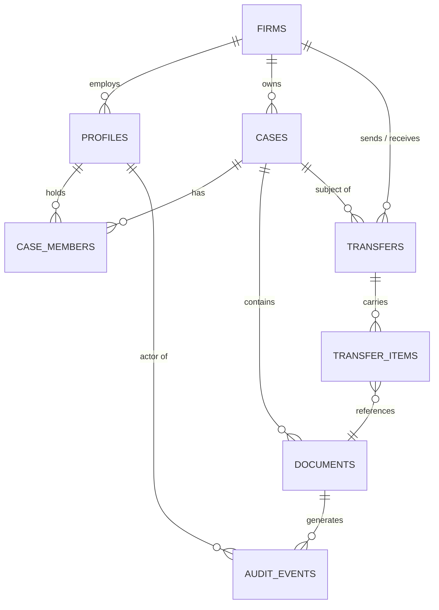

# BriefLock — Canonical Domain Model (v2.0)

> **Status:** 🔒 LOCKED — the normative data model, access rule, and state machines. Companion to `DECISIONS.md`.
> **Rule:** Schema, API, UI, and test documents must implement this model exactly. Conflicts resolve in favor of this file.

---

## 1. Entity Overview



| Entity | Purpose |
|---|---|
| `firms` | Tenant root. Every data row is firm-scoped. |
| `profiles` | Lawyer/staff user; extends `auth.users`; carries role + clearance. |
| `cases` | Legal matter; owns documents; carries default security level. |
| `case_members` | Assignment of users (own-firm or external) to a case. |
| `documents` | One immutable PDF; security level, SHA-256, scan status. |
| `transfers` / `transfer_items` | Cross-firm send/receive with acceptance gate. |
| `audit_events` | Immutable, hash-chained telemetry for everything. |

---

## 2. Entity Definitions

### 2.1 `firms`
`id uuid pk` · `name text` · `slug citext unique` · `settings jsonb` (retention days, watermark defaults, l3_view_only default) · `plan text default 'trial'` · `created_at` · `deactivated_at`

### 2.2 `profiles` (extends `auth.users`)
`id uuid pk = auth.users.id` · `firm_id fk→firms` · `email citext` · `full_name text` · `role text check in ('firm_admin','lawyer','paralegal')` · `clearance_level int check in (1,2,3)` · `is_active boolean default true` · `created_at` · `deactivated_at`
Constraint: **exactly one clearance level per user** (P6). Role changes and clearance changes are admin-only operations and always audited.

### 2.3 `cases`
`id uuid pk` · `firm_id fk→firms` · `title text` · `case_reference text` (firm-local human ref, unique per firm) · `default_security_level int check in (1,2,3)` · `status text check in ('open','closed','archived') default 'open'` · `allow_l3_download boolean default true` (P5 per-case flag) · `legal_hold boolean default false` · `retention_days int null` · `created_by fk→profiles` · `created_at` · `closed_at`

### 2.4 `case_members`
`case_id fk` · `user_id fk→profiles` · `role text check in ('lead','member','external') default 'member'` (`external` = cross-firm recipient admitted via transfer) · `added_by fk→profiles` · `added_at` · PK `(case_id, user_id)`

### 2.5 `documents`
`id uuid pk` · `case_id fk` · `firm_id fk→firms` (owning firm, denormalized for RLS) · `filename text` · `storage_path text unique` (`{firm_id}/{case_id}/{document_id}/{filename}`) · `size_bytes bigint check ≤ 104857600` · `mime_type text check = 'application/pdf'` · `sha256 char(64)` (content hash, tamper-evidence) · `security_level int check in (1,2,3)` · `scan_status text check in ('pending','clean','infected','error') default 'pending'` · `scan_method text` (`magic-bytes-mvp` now, `clamav` later) · `description text null` · `uploaded_by fk→profiles` · `uploaded_at` · `superseded boolean default false`
Immutable content (V1). Level may only **rise** (uploader) or change with admin role (both audited).

### 2.6 `transfers`
`id uuid pk` · `case_id fk` · `from_firm_id fk` · `to_firm_id fk` (≠ from) · `created_by fk→profiles` · `status text check in ('draft','sent','accepted','rejected','cancelled','revoked') default 'draft'` · `message text null` · `sent_at` · `responded_at` · `created_at`

### 2.7 `transfer_items`
`transfer_id fk` · `document_id fk` · PK `(transfer_id, document_id)`
On `accepted`: each recipient user (designated at send time, stored in `transfers.recipient_user_ids uuid[]`) is inserted into `case_members` with role `external` (idempotent), and gains access to the transferred documents under the full Access Rule (§3).

### 2.8 `audit_events` (append-only)
`id uuid pk` · `occurred_at timestamptz default now()` · `actor_user_id fk→profiles null` (null = system) · `firm_id fk null` · `case_id fk null` · `document_id fk null` · `transfer_id fk null` · `action text` (enum §6) · `result text check in ('allow','deny','info')` · `deny_reason text null` (§3.2) · `ip_hash text null` · `country text null` · `city text null` · `user_agent text null` (truncated 200 chars) · `details jsonb null` · `prev_hash char(64)` · `entry_hash char(64)`
**No UPDATE/DELETE policies exist for any role.** Insert = service role only. Chain: `entry_hash = SHA256(prev_hash ‖ canonical_json(all fields except hashes))`, genesis `prev_hash` = 64×'0'. Retained indefinitely (append-only; events are small). Export endpoint emits NDJSON for cold archive.

---

## 3. The Access Rule (normative)

Content access (`GET /documents/:id/content`) is granted **iff all** checks pass, evaluated server-side:

| # | Check | Failure reason |
|---|-------|----------------|
| A1 | Authenticated, `is_active = true` | `UNAUTHENTICATED` / `DEACTIVATED` |
| A2 | `profile.firm_id = document.firm_id` **OR** profile ∈ `transfers.recipient_user_ids` of an **accepted** transfer carrying this document | `FIRM_MISMATCH` |
| A3 | Active `case_members` row for `(document.case_id, profile.id)` (own-firm or `external`) | `NOT_CASE_MEMBER` |
| A4 | `profile.clearance_level = document.security_level` — **exact match** | `CLEARANCE_MISMATCH` |
| A5 | `document.scan_status = 'clean'` | `UNSCANNED` / `INFECTED` |
| A6 | Case not `archived` for **new** activity (reading remains allowed; downloads still gated by §3.1) | `CASE_ARCHIVED` |

**Firm-admin exception (P7):** admins may read metadata and audit trails of their firm's cases; **never** content unless A1–A5 pass for them too.

### 3.1 Download gate (L3)
If `document.security_level = 3` AND `case.allow_l3_download = false` → view allowed (watermarked), download attempt denied with reason `DOWNLOAD_BLOCKED_L3`, logged as denial.

### 3.2 Deny reasons (canonical enum)
`UNAUTHENTICATED` · `DEACTIVATED` · `FIRM_MISMATCH` · `NOT_CASE_MEMBER` · `CLEARANCE_MISMATCH` · `UNSCANNED` · `INFECTED` · `CASE_ARCHIVED` · `DOWNLOAD_BLOCKED_L3`

**Every denial writes an `audit_events` row** (`result='deny'`, `deny_reason`). Repeated denials (≥5 on the same profile within 15 min) raise an alert to the firm admin.

## 3.3 Clearance matrix (the product's core invariant)

| User ↓ \ Document → | L1 | L2 | L3 |
|---|---|---|---|
| **L1** | ✅ view+download | ❌ | ❌ |
| **L2** | ❌ | ✅ view+download (watermark) | ❌ |
| **L3** | ❌ | ❌ | ✅ view+download (watermark; per-case view-only flag) |

Only the diagonal allows access. Non-diagonal = `CLEARANCE_MISMATCH` denial, logged.

---

## 4. Clearance Levels

| Level | Name | Example matter | Handling |
|---|---|---|---|
| 1 | Standard | Property theft, contracts | Watermark optional |
| 2 | High | Murder case | Watermark mandatory |
| 3 | Maximum | War crimes | Watermark mandatory; per-case download gate |

Extensible to L4/L5 by enum growth; exact-match rule unchanged.

---

## 5. Transfer State Machine

```
draft ──send──▶ sent ──accept──▶ accepted
                  │  └─reject──▶ rejected
                  └─cancel──▶ cancelled            accepted ──revoke(owning admin)──▶ revoked
```
- `send` requires sender = owning-firm member of the case; recipients designated from the receiving firm's active profiles; notification email on send.
- `accept`/`reject` permitted only to designated recipients; acceptance inserts `external` case members (idempotent) + `transfer.accepted` audit.
- `revoke` (owning-firm admin only) removes future access; past access remains fully audited. All transitions audited with `transfer_id`.

---

## 6. Audit Action Enum (canonical)

`auth.login_failed` · `member.added` · `member.removed` · `member.role_changed` · `clearance.changed` · `case.created` · `case.updated` · `case.closed` · `case.archived` · `document.uploaded` · `document.viewed` · `document.downloaded` · `document.access_denied` · `document.level_raised` · `document.level_lowered` · `document.scan_failed` · `transfer.created` · `transfer.sent` · `transfer.accepted` · `transfer.rejected` · `transfer.cancelled` · `transfer.revoked` · `firm.updated`

---

## 7. Documents & Storage

- Private Supabase Storage bucket; path `{firm_id}/{case_id}/{document_id}/{filename}`; **no public buckets**.
- Upload flow: validate PDF magic bytes + size ≤ 100 MB → store → compute SHA-256 → `scan_status='pending'` → in-function structure scan (D11) → `clean`|`infected`. Access blocked while not `clean`.
- Delivery: **signed URLs, TTL ≤ 60 s**, issued only after the audit `document.viewed`/`document.downloaded` row is committed (A1).
- Viewer: pdf.js in a CSP-locked sandboxed iframe + dynamic watermark overlay (W1).

## 8. Search (clearance-aware)

`GET /search` returns only documents/cases the caller can access under §3. Titles, counts, and existence of inaccessible items are **never** leaked — filtering happens in the query, not after.

## 9. Notifications (email)

`transfer.sent` → recipients · `transfer.accepted/rejected` → sender · repeated-denial alert → firm admin · invite → new user. All emails transactional (Supabase/Resend); no marketing.

## 10. Multi-Tenancy Invariant

Every table carries `firm_id` (or resolves to one via a parent). RLS must make cross-firm rows structurally invisible, including through search, counts, and error messages. An automated RLS test suite proving this invariant is a **release blocker**.
