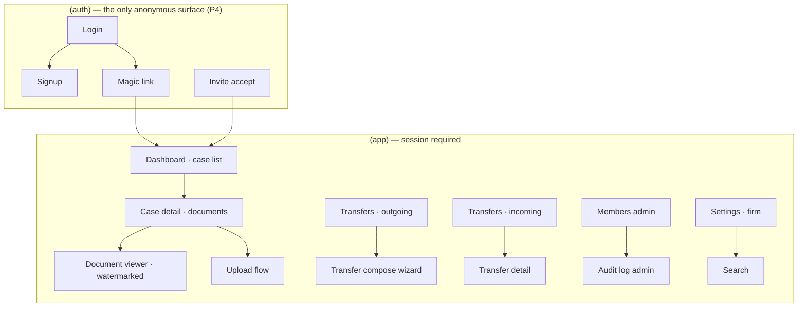

# BriefLock — UI/UX Design Specification

**Version 2.0 — Regenerated for the legal document exchange core idea**

| Field | Value |
|---|---|
| **Status** | Draft for implementation |
| **Supersedes** | UI/UX v0.1 (v1 product: short-link dashboard, link table, click analytics, QR codes) — archived in `docs-v1-archive/` |
| **Contract** | `DECISIONS.md` (🔒) + `DOMAIN_MODEL.md` (🔒) govern. Access rule A1–A6 and the diagonal clearance matrix (§3.3) shape every screen. |
| **Stack** | Next.js 16 App Router · TypeScript · Tailwind CSS · shadcn/ui · pdf.js viewer (FRONTEND_ARCH §4) |
| **Golden rules** | (1) **Never leak** — the UI never reveals the existence, filename, or level of a document/case the user can't access. (2) **Denial clarity without disclosure** — uniform denial states, exact reasons visible only to admins in the audit view. (3) **Clearance is identity** — every user always knows their own clearance and what it means. (4) **Watermark is not optional** for L2/L3 (W1). |

---

## 1. Design Principles

| # | Principle | Consequence in the product |
|---|---|---|
| 1 | **Deny safely** | Any A1–A5 failure renders the same "No access" interstitial (§2.12). No content, no filename, no level, no hint which check failed. |
| 2 | **Diagonal matrix as mental model** | Onboarding + profile page explain compartments explicitly: "You are cleared for **L2 only**. L1 and L3 documents are invisible to you — this is deliberate." |
| 3 | **Audit transparency for admins** | Firm admins see the full trail (§2.9) including precise denial reasons; end users never do. |
| 4 | **Immutability is visible** | No edit affordances on documents anywhere; "Replace" means upload a new document (V1). |
| 5 | **Two surfaces, hard boundary** | `(auth)` = login/signup/invite-accept only (P4). Everything else is in `(app)` behind a session. No share links, no public pages. |
| 6 | **Calm, professional, dense** | Law-firm users live in tables and lists; optimize for scanning, filter, act — not for delight. Neutral palette; security states carry the only strong colors. |
| 7 | **Scan-gate honesty** | Uploads visibly traverse `pending → clean/infected/error` (§2.5); an uncleared document is labeled "Quarantined", never silently hidden. |

## 2. Information Architecture

Route groups (mirrors FRONTEND_ARCH §1): `(auth)/login`, `(auth)/signup`, `(auth)/invite/accept`, `(app)/cases`, `(app)/cases/[caseId]`, `(app)/cases/[caseId]/documents/[documentId]`, `(app)/transfers`, `(app)/members`, `(app)/audit`, `(app)/settings`, `(app)/search`.

## 3. Screens

### 3.1 Login / Signup / Magic link — `(auth)`

- Single centered card, firm-neutral branding, **no product content** in the chrome.
- Email + password primary; "Email me a sign-in link" secondary (D10: Supabase Auth UI flows, no custom endpoints).
- Auth errors are generic ("Invalid email or password") — never "no such user".
- After auth: fetch `/api/v1/firms/current`; no firm → route to firm creation (§3.2b below: one screen: name + slug).
- Failed-login feedback stays generic; the platform logs `auth.login_failed` (never shown to users).

### 3.2 Invite accept — `(auth)/invite/accept?token=…`

- Token in URL → validating state → **profile form**: full name + password (role/clearance/firm are already fixed by the invite — shown read-only: "You have been invited to **Hartwell & Roe LLP** as **lawyer**, clearance **L2**").
- Expired/used/unknown token → generic "This invitation is no longer valid" (no which-failure disclosure). Success → dashboard.

### 3.2b Firm creation (first-run)

One screen: firm name, slug (auto-suggested, availability-checked). Then straight to dashboard with an empty-state that offers "Create your first case".

### 3.3 Dashboard — `(app)/cases` (case list)

| Element | Detail |
|---|---|
| Table columns | Title · Case ref · Security default (L badge) · Status (open/closed/archived chip) · Documents (count visible to **me**) · Last upload |
| Scope toggle | `My cases` (default) / `All firm cases` (admin only — metadata view per P7, visually labeled "Admin metadata view") |
| Filters | Status, level, text search (title/reference) |
| Primary action | `New case` (any firm member) |
| Row click | → Case detail |
| Empty state | "No cases yet — create one to start uploading documents." (Admin `All firm cases` empty ≠ user empty; never mix scopes) |

### 3.4 Case detail — `(app)/cases/[caseId]`

- **Header**: title, case reference, status chip, admin controls (Edit, Close, Archive — confirm dialogs; Archive warning: "New uploads, transfers and member changes will be blocked. Reading remains possible.").
- **Flag row** (admin-editable): `L3 downloads: allowed/view-only` (P5), `Legal hold: on/off`, `Default level: L1/L2/L3` — each change asks for explicit confirmation; each is audited.
- **Members tab**: table of case members (name, member role lead/member/external, added by/at). `external` rows show firm name and are marked "via transfer". Admin/lead can add own-firm members and change roles.
- **Documents tab** → §3.5.
- **Transfers tab**: outgoing transfers of this case (§3.9).

### 3.5 Document list — documents tab of case detail

| Element | Detail |
|---|---|
| Columns | Filename · Level (L badge) · Scan status chip · Size · Uploaded by · Uploaded at · Actions |
| Level badges | `L1` slate · `L2` amber · `L3` rose (consistent everywhere, incl. search §3.11) |
| Scan chips | `Pending` (spinner, gray) · `Clean` (green check) · `Infected` (red, row locked) · `Error` (amber, retry available) |
| Filtering | level, scan status, filename/description text; server-filtered (§8 search semantics) |
| Actions | `View` / `Download` (enabled only when diagonal match — though the row wouldn't render otherwise) · `Raise level` (case member) · `Lower level` (admin, reason modal) |
| **What you never see** | Documents above/below your clearance do not exist in this list — no "3 hidden documents" hints, no disabled rows (DOMAIN_MODEL §8) |

### 3.6 Upload flow — modal over case detail

1. **Select**: dropzone ("Drop a PDF, max 100 MB") — PDF-only, client-side type/size pre-checks with inline errors before anything is sent. Fields: filename (prefilled), description (optional), **security level** (case default preselected; helper text: "You can raise the level here. Lowering it later requires a firm admin and is audited.").
2. **Upload**: determinate progress bar; bytes go **directly to the private bucket** via the one-time signed URL — never through the app server. Failures offer Retry (new URL).
3. **Scan gate**: on complete, the document row appears at the top with a `Pending` chip and a "Scanning…" shimmer; the modal closes. The row transitions `Pending → Clean` / `Infected` / `Error` live (poll or SWR revalidate). `Infected` shows a locked red row: "Quarantined — this document failed the malware scan and cannot be viewed or downloaded."

### 3.7 Document viewer — `(app)/cases/[caseId]/documents/[documentId]`

| Element | Detail |
|---|---|
| Layout | Full-height overlay route; header: filename, L badge, `Viewed · access is logged` hint, Close |
| Renderer | pdf.js inside a **CSP-locked, sandboxed iframe** (FRONTEND_ARCH §4); no original file URL is ever exposed to the main document context |
| Watermark | Dynamic overlay **always rendered for L2/L3** (W1): viewer full name + UTC timestamp, repeated diagonal tiling, pointer-events none (§6) |
| Download | Button calls content endpoint with `disposition=download`; **hidden entirely** for L3 in a view-only case (P5) — and an attempt via URL is still caught server-side (`DOWNLOAD_BLOCKED_L3` interstitial) |
| Session expiry | Signed URLs live ≤ 60 s; the client silently re-requests ~10 s before expiry, preserving scroll position. On failure → denial interstitial |
| Copying | Text selection remains possible — the watermark is deterrence, not DRM (matching SECURITY.md's threat model); printing is best-effort blocked (viewer shortcuts disabled) |

### 3.8 Transfers — outgoing — `(app)/transfers`

Tabs: `Outgoing` / `Incoming`. Outgoing table: Case · To firm · Documents (count + level badges) · Status chip · Sent at · Actions.

| Status chip | Color | Available actions |
|---|---|---|
| `Draft` | gray | Edit, Send, Cancel |
| `Sent` | blue | Cancel (sender side) |
| `Accepted` | green | Revoke (**owning-firm admin only**, destructive confirm) |
| `Rejected` | red-gray | — (terminal) |
| `Cancelled` | gray | — (terminal) |
| `Revoked` | dark red | — (terminal) |

### 3.9 Transfer compose wizard (3 steps)

1. **Recipients**: pick the receiving firm (search), then its **active** members (name + email; clearance is never displayed cross-firm). 1–10 recipients; helper: "Recipients must accept before they can see anything."
2. **Documents**: multi-select from the case's documents **visible to the sender**; selected list shows level badges; helper: "Recipients can only view documents matching their own clearance."
3. **Review**: summary card (firm, recipients, document list, message ≤ 1000 chars) → `Save draft` or `Send now`. Send confirm: "Recipients will be notified by email."

### 3.10 Incoming transfers & detail

- Incoming table: From firm · Case · Documents (count + badges) · Received at · Status · Actions (`Accept` / `Reject` on `Sent` only).
- **Accept** confirm dialog: "You will become an external member of «{case}» from {firm} and gain access to the listed documents that match your clearance ({Lx})." — honest about the diagonal rule up front.
- **Detail page**: item list with level badges, recipients, message block, and a status timeline (Created → Sent → Responded / Revoked). `Revoke` (owning admin) confirms: "External members lose access to the transferred documents immediately. Past access remains in the audit log."
- After acceptance, the case appears in the recipient's "My cases"; its Documents tab shows **only** what the full access rule allows them (typically the transferred documents at their clearance).

### 3.11 Firm members admin — `(app)/members` (admin only)

| Element | Detail |
|---|---|
| Table | Name · Email · Role (select) · Clearance (L badge + select) · Status (active/deactivated) · Last seen |
| Role select | `firm_admin` / `lawyer` / `paralegal` with one-line descriptions; changing → confirm modal |
| Clearance select | Confirm modal states the compartment switch plainly: "Dana will **lose access to all L2 documents** and **gain access to L3 documents** immediately. Her past access remains in the audit log." (audited as `clearance.changed`) |
| Deactivate | Confirm: "loses all access immediately" (audited `member.removed`); row grays; `Reactivate` re-enables (audited) |
| Last-admin guard | UI disables demoting/deactivating the final active admin; server backstop `409` (§4.7 of API_SPEC) |

### 3.12 Audit log — `(app)/audit` (admin only)

- **Filters**: action (grouped select: auth / member / case / document / transfer / firm), result (allow/deny/info), deny reason, actor, case, document, date range.
- **Table**: Time · Actor · Action (monospace, e.g. `document.access_denied`) · Result chip · Target (links to case/document/transfer where the admin may navigate) · Geo (country/city, truncated `ip_hash` prefix) · Details expander.
- **Deny rows are red-tinted and show `deny_reason`** (`CLEARANCE_MISMATCH`, `INFECTED`, …) — this is the *only* surface where precise denial reasons are visible (API_SPEC §1.3).
- Repeated-denial alert (≥5 on one profile in 15 min, DOMAIN_MODEL §3) surfaces as a banner: "Unusual denial activity by {user} — review the audit log."
- `Export NDJSON` button (date-range picker) → file download; the export itself is audited. No document content appears anywhere in this view (P7 metadata-only).

### 3.13 Firm settings — `(app)/settings` (admin only)

Firm name/slug · Defaults: retention days, watermark-on-L1 toggle, `L3 view-only by default for new cases` (P5 default) · Plan display (read-only). Every save → `firm.updated` audit; a subtle "Changes are logged in the audit trail" note normalizes auditing.

### 3.14 Search — `(app)/search`

- Global search field in the app shell (`/` focuses it); results grouped **Cases** and **Documents** (document rows show case title + level badge).
- Server-filtered by the full access rule (DOMAIN_MODEL §8) — filtering happens in the query: no "hidden results", no disabled rows, no counts of inaccessible items. Empty state is plain "No results".
- Results navigate directly to the case/document; a document the user can see metadata for but not open (foreign firm via link) still resolves to the same uniform interstitial.

### 3.15 Denial interstitials — one component, strict copy rules

Single `AccessDeniedInterstitial`: lock glyph, headline **"You don't have access to this document."**, static sub-line: "This may be outside your clearance, outside your firm's cases, or the document may be quarantined." — *static enumeration of possible causes is uniform and discloses nothing*.

| Code | Headline | Extras |
|---|---|---|
| `ACCESS_DENIED` (all A1–A5) | "You don't have access to this document." | static sub-line; back button |
| `DOWNLOAD_BLOCKED_L3` | "Downloads are disabled for this document." | "L3 documents in this case are view-only. You can still view it (watermarked)." |
| `CASE_ARCHIVED` (write paths) | "This case is archived." | "New uploads, transfers and member changes are blocked. You can still view its documents." |
| `NOT_FOUND` (404) | "Not found." | identical layout — probes learn nothing |
| `UNAUTHENTICATED` / session loss | redirect to login with return URL | — |
| `RATE_LIMITED` (429) | "Too many requests." | "Try again in {Retry-After} s." |

### 3.16 Loading / empty / error matrix

| Surface | Loading | Empty | Error |
|---|---|---|---|
| Lists (cases, docs, transfers, audit) | row skeletons | purposeful empty state + primary action | inline banner + retry |
| Document viewer | full-pane spinner + "Preparing secure view…" | — | denial interstitial |
| Forms | button spinner, inputs locked | — | field errors inline; global banner for 5xx |
| Search | debounced shimmer | "No results" | "Search failed — retry" |

## 4. Component Library (shadcn/ui base)

| Component | Notes |
|---|---|
| `LevelBadge` | L1/L2/L3 — slate/amber/rose; used on every document row, search result, transfer item |
| `ScanChip` | pending/clean/infected/error states with icons; infected is non-interactive |
| `StatusChip` | case status + transfer status variants (§3.8 colors) |
| `AccessDeniedInterstitial` | §3.15 — single source of denial UI |
| `WatermarkOverlay` | §6 — canvas overlay, deployed only inside the viewer iframe |
| `ConfirmDialog` | used for every audited, irreversible, or access-changing action (§1 principle 3: confirmations name the consequence) |
| `DocumentTable` / `CaseTable` | shared table primitives with column config; server-driven pagination |
| `UploadModal` | 3-step flow (§3.6) |
| `TransferWizard` | 3-step flow (§3.9) |
| `EmptyState` | icon + headline + description + optional primary action |

## 5. Visual Language

- **Type**: Inter (UI) + JetBrains Mono (action names, hashes, references). 14 px base in tables, 16 px in forms.
- **Color tokens**: neutral slate surfaces; `--level-1` slate · `--level-2` amber-600 · `--level-3` rose-600; success emerald; danger red-600 reserved for security states (infected, deny, revoke); primary indigo for actions.
- **Density**: 36 px table rows, 8 px vertical rhythm; generous whitespace only on `(auth)` surfaces.
- **Iconography**: Lucide; lock/shield glyphs exclusively for security semantics.

## 6. Watermark Specification (W1)

| Aspect | Spec |
|---|---|
| Content | Viewer full name + UTC timestamp (`2026-10-16 18:04:22 UTC`) rendered on every page |
| Pattern | Repeated 45° diagonal tiling, ~35% opacity, dark slate on light pages / light on dark, sized to remain legible at 100% zoom |
| Rendering | HTML5 canvas overlay inside the viewer iframe, `pointer-events: none`, re-rendered on page change and resize; regenerated per session (timestamp = signed-URL issue time) |
| When | **Mandatory for L2 and L3**; optional for L1 (firm setting `watermark_l1`) |
| Integrity | Overlay lives in the CSP-locked iframe above the pdf.js canvas; removing it requires breaking the sandbox (out of scope for browser-level attackers; see SECURITY.md T-thresholds) |

## 7. Accessibility (WCAG 2.1 AA)

- Full keyboard navigation: table rows focusable, viewer paginable with ←/→, all dialogs trap focus, `Esc` closes.
- Color never the sole carrier: level badges include the literal `L1/L2/L3` text; scan chips include icon + text.
- Live regions announce upload/scan state transitions ("Scanning complete — document is clean").
- Watermark must not defeat contrast requirements: 35% opacity diagonal under AA-tested text zones (viewer text contrast is pdf.js-controlled; overlay tiles avoid 100%-white full columns).
- Interstitials and dialogs get `role="alertdialog"` + explicit focus.

## 8. Responsive & Breakpoints

| Range | Layout |
|---|---|
| ≥ 1280 px | Full two-pane (list + detail) where applicable; tables complete |
| 768–1279 px | Single pane; tables gain horizontal scroll with sticky first column |
| < 768 px | Responsive-usable (lists collapse to cards) but **not a design target** (MVP desktop-first per brief); viewer works with tap paging |

## 9. Copy Rules (microcopy)

| Situation | Copy |
|---|---|
| Generic denial | "You don't have access to this document." + static sub-line (§3.15) — never per-reason variants |
| Raising level | "This document will require clearance L{new}. Existing viewers at other levels will no longer see it." |
| Lowering level (admin) | Reason textarea required: "Lowering a security level widens access. Give a reason — it will be audited." |
| Send transfer | "Recipients will be notified by email. They must accept before they can see anything." |
| Revoke transfer | "External members lose access immediately. Past access remains in the audit log." |
| Archive case | "New activity is blocked. Reading remains possible." |
| Audit hint | "Every access, denial and change is recorded in your firm's audit log." |
| Quarantine | "Quarantined — this document failed the malware scan and cannot be viewed or downloaded." |

## 10. QA Checklist (pre-ship, pairs with TESTING_STRATEGY §E2E)

1. L2 user in an L3 case sees **no** L3 rows, no hidden-count hints, and search returns no L3 documents.
2. Every denial path renders the same interstitial; DevTools response inspection reveals no reason codes on `ACCESS_DENIED`.
3. Watermark present with correct name/timestamp on every L2/L3 page; absent for L1 when firm setting off.
4. L3 view-only case: no download control; direct content call returns the `DOWNLOAD_BLOCKED_L3` interstitial.
5. All audited actions fire exactly one audit event (raise/lower level, member changes, transfers, view/download).
6. Interstitial text matches §3.15 verbatim (copy freeze).
7. Keyboard-only pass: upload a document, view it, raise its level without touching the mouse.
8. Scan-gate states all reachable in demo seed (pending/clean/infected/error).

## Changelog

| Version | Change |
|---|---|
| 2.0 | Regenerated for the legal document exchange core idea: two-surface IA per P4, case/document surfaces, diagonal-clearance UX, watermarked pdf.js viewer, transfer wizard, admin audit view, uniform denial interstitials. Removed all v1 link/analytics screens. |
| 0.1 | Initial draft (v1 product — retired). |
